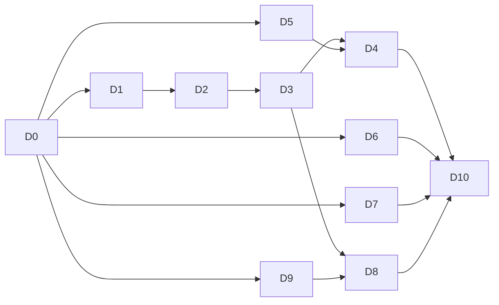

# Backlog de despliegue — Etapa 5 (Despliegue)

Este archivo es la **fuente de verdad** del trabajo de la Etapa 5. Define cada
tarea, qué material del repo ya existe para resolverla y qué falta. El Google Doc
del entregable (D10) solo resume y enlaza a `docs/deployment/` y `docs/manuals/`.

## Qué pide la entrega

> En esta etapa se documenta el despliegue del proyecto, considerando lo siguiente:
> planeación de la migración del software (despliegue); validación de infraestructura
> computacional (health/check); monitoreo de infraestructura computacional
> (dashboards de la nube); garantía de calidad de servicio (SLAs). Documentación:
> manual de usuario y manual de instalación.

| Punto de la entrega | Archivo | Tarea |
|---|---|---|
| Planeación de la migración del software | `docs/deployment/MIGRATION-PLAN.md` | D1 |
| Implantación y cumplimiento de requerimientos (criterio de la rúbrica) | `docs/deployment/IMPLEMENTATION.md` | D1 |
| Validación de infraestructura (health/check) | `docs/deployment/INFRA-VALIDATION.md` | D2 |
| Monitoreo de infraestructura (dashboards de la nube) | `docs/deployment/MONITORING.md`, `examples/python_health/` | D3 |
| Garantía de calidad de servicio (SLA) | `docs/deployment/SLA.md`, `docs/deployment/BACKUP-LOG.md` | D4, D5 |
| Manual de usuario | `docs/manuals/USER-MANUAL.md` | D6, D7 |
| Manual técnico | `docs/manuals/TECHNICAL-MANUAL.md` | D8 |
| Manual de instalación | `docs/manuals/INSTALLATION.md` | D9 |
| Entregable (Google Doc) | — | D10 |

### Estructura pedida (pizarrón)

**Manual de usuario:** Introducción · Vistazo general · Prerrequisitos ·
Funciones (por cada una: descripción, pantalla(s), descripción de los elementos de
la pantalla, cómo se utiliza) · F.A.Q.

**Manual técnico** (audiencias: desarrollador, administrador técnico/sysadmin,
mantenimiento, soporte, operación): Introducción · Alcance · Infraestructura ·
Requerimientos técnicos (librerías → versiones, lenguajes → versiones, S.O. →
versiones, cloud → detalles) · Repositorios de código · Instalación (app móvil:
cómo se construye y cómo se instala; back end: cómo se construye y cómo se
despliega; BD: cómo se inicializa) · Monitoreo · Pruebas (cómo se corren las
pruebas) · Contacto · Anexo (diagramas).

**SLA (Service Level Agreement):** tiempo de respuesta de funciones críticas
(milisegundos) · disponibilidad 80 % (≈ 292 de 365 días; el pizarrón dice "300
días") · capacidad (usuarios simultáneos) · privacidad (no se almacenan datos
personales) · respaldo cada 7 días · respuesta a incidentes en 24 horas.

## Cómo usar este backlog

- **IDs:** cada tarea tiene un ID fijo (`D0`…`D10`).
- **Estado:** `pendiente` → `en curso` → `hecho`. Una tarea pasa a `hecho` solo con
  su PR fusionado y su aceptación cumplida; el PR se anota como evidencia.
- **Orden:** se respetan las dependencias (**Depende de**). Las tareas sin
  dependencias arrancan ya.
- **Esqueletos:** cada entregable ya existe con sus encabezados, un bloque
  "Fuentes" por sección y marcadores `_Pendiente (Dn)_`. Se reemplaza el
  marcador por el contenido; no se borran secciones pedidas por el pizarrón.

### Reglas

- **Sin secretos en Git:** nunca contraseñas, tokens, `service_role`, cadenas de
  conexión ni valores de secretos de Functions. Los secretos se citan solo por
  **nombre** (`supabase secrets list` muestra nombres y digests). Capturas de
  dashboards: tapar claves, correos y IDs sensibles antes de subirlas.
- **Rutas:** en `docs/deployment/` y `docs/manuals/` (salvo este backlog) escribir
  siempre la ruta completa desde la raíz del repo, también en los enlaces
  Markdown (`[x](/docs/DEPLOYMENT.md)`). `npm run test:docs` lo comprueba en la CI
  y falla si se cita un archivo que no existe: no citar un archivo antes de crearlo.
- **Evidencia, no promesas:** no inventar mediciones ni resultados. Lo que no se
  pudo medir se marca "sin medir" con la razón (igual que en la Etapa 4).
- **Producción:** sigue bloqueada (fail-closed) hasta que la Asociación de Hoteles
  de Chihuahua apruebe un geofence (`README.md`, "Current blocker"). El despliegue
  real se ensaya y valida sobre **staging** (`dcvihomkxkutkckmjvmp`, Supabase Free).
- **Capturas:** van junto al documento que las usa (`docs/manuals/img/`,
  `docs/deployment/img/`), en PNG, con nombre `<nn>-<pantalla>.png`.
  `promo-video/material/` ya tiene capturas recientes de casi todas las pantallas
  (sirven de base o de referencia).

### Dependencias

---

## D0 · Backlog y esqueletos de la Etapa 5
- **Estado:** en curso
- **Depende de:** nada.
- **Objetivo:** que cada tarea tenga una guía clara y documentos con estructura
  para solo juntar información.
- **Alcance:** este backlog; esqueletos de `docs/deployment/` y `docs/manuals/`;
  navegación en `docs/README.md` y `AGENTS.md`; la comprobación de rutas
  (`scripts/check-doc-paths.mjs`) también revisa `docs/deployment/` y
  `docs/manuals/`.
- **Aceptación:** PR fusionado con la CI en verde.

## D1 · Plan de migración del software (despliegue)
- **Estado:** en curso (rama `docs/etapa5-despliegue`, 2026-10-24)
- **Depende de:** D0.
- **Objetivo:** el plan formal de cómo se lleva el sistema de un entorno a otro
  (local → staging → producción), qué se migra, en qué orden, cómo se verifica y
  cómo se revierte.
- **Fuentes a reutilizar:**
  - `docs/DEPLOYMENT.md`: "Remote-first workflow", "Project bootstrap" (8 pasos),
    "Required preflight and promotion", "Post-deploy smoke check", "Promotion and
    verification", "Milestone export and restore runbook".
  - `supabase/migrations/` (lista ordenada de migraciones), `db/schema.sql`
    (objetivo), `supabase/config.toml`.
  - `eas.json` (perfiles `development`, `preview`, `production`), `docs/REVIEWING.md`.
  - `docs/SECURITY.md` "Secret and fail-closed inventory" (nombres de secretos).
  - `docs/product/GEOFENCE-CANDIDATE.md` (aprobación del geofence = bloqueo de producción).
  - `docs/testing/PLAN.md` (formato de tabla y Gantt `mermaid` que ya usamos).
- **Alcance (`docs/deployment/MIGRATION-PLAN.md`):**
  1. Entornos: local, staging (proyecto Free actual), producción (segundo proyecto
     Free o plan de pago; aún no existe). Tabla con propósito, URL/ref (sin
     secretos), quién opera y qué datos contiene.
  2. Inventario de componentes a migrar: migraciones SQL (con su orden), Function
     `api`, secretos (solo nombres), bucket privado y políticas, cuentas de
     Asociación/Administrator, `deployment_metadata.environment`, geofence aprobado,
     build móvil (`production` en EAS) y variables `EXPO_PUBLIC_*`.
  3. Estrategia: big-bang sobre proyecto nuevo (no hay datos que mover de un sistema
     anterior: hoy la Asociación no tiene sistema; `docs/product/PROBLEM-CONTEXT.md`).
     Explicar por qué no se copian datos de staging a producción.
  4. Procedimiento paso a paso con responsable y verificación por paso (tabla Paso /
     Comando o acción / Verificación / Responsable), reutilizando el preflight de
     `DEPLOYMENT.md`.
  5. Rollback: qué hacer si falla cada paso (migración: restaurar desde exportación
     de D5; Function: redeploy de la versión anterior por commit; app: build anterior).
  6. Criterios go/no-go (checklist) y riesgos (cuotas Free, pausa por inactividad,
     geofence sin aprobar, cuentas de tiendas).
  7. Cronograma con Gantt `mermaid` y ventana de despliegue.
  8. **Ensayo sobre staging:** ejecutar el procedimiento de los pasos que no rompen
     nada (`supabase db push --dry-run`, `supabase functions deploy api --use-api`,
     smoke check) y registrar fecha, versión de CLI, commit desplegado y resultado.
- **Aceptación:** las 8 secciones llenas; el ensayo sobre staging registrado con
  evidencia (salida de comandos sin secretos); enlazado desde `docs/DEPLOYMENT.md`.

## D2 · Validación de infraestructura (health/check)
- **Estado:** en curso (rama `docs/etapa5-despliegue`, 2026-10-24)
- **Depende de:** D1 (usa sus entornos y su procedimiento).
- **Objetivo:** demostrar que la infraestructura desplegada está sana, con un
  checklist ejecutado y un health check automatizable.
- **Fuentes a reutilizar:**
  - Backend: `supabase/functions/api/routes/health.js`,
    `supabase/functions/api/controllers/healthController.js`,
    `supabase/functions/api/services/healthService.js` y su repositorio
    (`GET /health` responde 200 `{ok, database: 'up'}` o 503 `database_unavailable`).
  - `docs/API.md` (contrato de `GET /health`), `docs/DEPLOYMENT.md` "Post-deploy
    smoke check" y "Project bootstrap" (qué verificar).
  - `docs/SECURITY.md` (RLS, `app_backend` `NOBYPASSRLS`, bucket privado, signup deshabilitado).
  - `scripts/doctor.mjs` (patrón de script de diagnóstico con salida clara).
- **Alcance (`docs/deployment/INFRA-VALIDATION.md`):**
  1. **Checklist de infraestructura** ejecutado sobre staging, una fila por punto:
     extensiones PostGIS/pgcrypto; RLS activo en tablas de dominio; `app_backend`
     `NOBYPASSRLS` sin objetos propios; grants móviles vacíos; bucket aprobado
     privado; secretos requeridos presentes (solo nombres); signup público
     deshabilitado; advisors de seguridad y rendimiento de Supabase; TLS/HTTPS; la
     Function `api` desplegada corresponde al commit esperado. Columnas: punto,
     cómo se verifica (comando/consulta/pantalla), esperado, obtenido, fecha, quién.
  2. **Script de humo** `scripts/smoke.mjs` (Node, sin dependencias, sin secretos;
     `API_BASE_URL` por variable): `GET /health` (200 y `database: up`),
     `GET /public/clusters` y `GET /public/reports` (200), `POST /auth/v1/signup` →
     `422 signup_disabled`, y latencia de cada llamada en ms. Sale con código 1 si
     algo falla. Con su test (`scripts/smoke.test.js`, `fetch` simulado) dentro de
     `npm test`. Agregar `npm run smoke`.
  3. **Health check del backend:** documentar qué valida y qué no. Evaluar si
     conviene ampliar la respuesta con `version` (commit/fecha de despliegue) y
     `latency_ms` de la base de datos, sin exponer datos sensibles; si se cambia,
     actualizar `docs/API.md`, presenter y tests.
  4. Registrar una ejecución del script y del checklist con fecha, commit y resultado.
- **Aceptación:** checklist completo con resultados; `npm run smoke` funciona
  contra staging y su test pasa en la CI; ejecución registrada.

## D3 · Monitoreo de infraestructura (dashboards de la nube)
- **Estado:** en curso (rama `docs/etapa5-despliegue`, 2026-10-24)
- **Depende de:** D2 (el health check que se monitorea).
- **Objetivo:** ver en tiempo real si el sistema está arriba y cómo usa sus
  recursos, con alertas, y cubrir RNF25 (hoy "monitor real pendiente" en
  `docs/testing/NON-FUNCTIONAL.md`).
- **Fuentes a reutilizar:**
  - `docs/DEPLOYMENT.md` "Retention and monitoring" (qué hay que monitorear) y
    "Managed Free planning assumptions" (cuotas).
  - `examples/python_health/` (FastAPI que consulta `/health`, con tests).
  - RNF25 en `docs/product/ETAPA1-REQUERIMIENTOS-V2.md`.
- **Alcance (`docs/deployment/MONITORING.md`):**
  1. **Dashboards de Supabase** (capturas en `docs/deployment/img/`, sin datos
     sensibles): Usage (BD, Storage, egress, invocaciones frente a la cuota Free),
     Edge Functions → `api` (invocaciones, errores, tiempos, logs), Database
     (Query Performance, conexiones), Auth (inicios de sesión/fallos), Reports.
     Por cada uno: qué muestra, umbral de alerta, qué hacer si se pasa.
  2. **UptimeRobot (plan gratuito):** monitor HTTP(s) cada 5 min sobre
     `GET /functions/v1/api/health` (palabra clave `"up"`), alertas por correo a
     los responsables y **página de estado pública**. Registrar el enlace.
  3. **Health check en Python, versión real** (`examples/python_health/`): pasar
     de ejemplo a monitor sintético. Revisa varios endpoints (`/health`,
     `/public/clusters`, `/public/reports`), mide latencia de cada uno, compara con
     los umbrales del SLA (D4) y responde un JSON con estado por componente (200 si
     todo está bien, 503 si algo falla). Configuración por variables de entorno,
     versiones fijas en `requirements.txt`, tests con `pytest` (ampliar los 3
     actuales). Desplegarlo en un servicio gratuito (por ejemplo Render) y agregarlo
     como segundo monitor de UptimeRobot (así también se mantiene despierto).
     Actualizar su README.
  4. Tabla **qué se monitorea** (RNF25): cuotas, errores, latencia, conexiones,
     pausa del proyecto, retención, scheduler, antigüedad de la última exportación
     (D5), auditoría. Por fila: herramienta, frecuencia, umbral, responsable.
     Lo que no se pueda automatizar en Free queda como revisión manual semanal.
  5. Procedimiento de alerta: quién recibe, cómo se escala y enlace con la
     respuesta a incidentes de 24 h (D4).
  6. Actualizar la fila TC-NF-25 de `docs/testing/NON-FUNCTIONAL.md` con la evidencia.
- **Aceptación:** capturas de los dashboards; UptimeRobot activo con página de
  estado; servicio Python desplegado, con tests en verde y monitoreado; tabla de
  RNF25 completa.

## D4 · Garantía de calidad de servicio (SLA)
- **Estado:** en curso (rama `docs/etapa5-despliegue`, 2026-10-24)
- **Depende de:** D3 (datos del monitor), D5 (respaldo ejecutado).
- **Objetivo:** el acuerdo de nivel de servicio del sistema, con cada compromiso
  medido o justificado.
- **Fuentes a reutilizar:**
  - `docs/testing/NON-FUNCTIONAL.md`: k6 (TC-NF-03: 2 usuarios virtuales, 60 s,
    p95 1.07 s, 0 % errores), RNF02 (mapa 3.8 s, envío 2.38 s en simulador).
  - `tests/load/public-read.js` (script k6).
  - RNF01, RNF02, RNF03, RNF13, RNF14 en `docs/product/ETAPA1-REQUERIMIENTOS-V2.md`;
    `docs/SECURITY.md` "Anonymous integrity and privacy"; `docs/DEPLOYMENT.md`
    (límites Free, sin SLA del proveedor, "Incident priorities").
  - `docs/testing/INCIDENTS.md` (formato de incidentes).
- **Alcance (`docs/deployment/SLA.md`):** una sección por compromiso, cada una con
  **métrica, objetivo, cómo se mide, evidencia, exclusiones**:
  1. **Tiempo de respuesta de funciones críticas (ms):** definir cuáles son
     (crear reporte, cargar mapa/clusters, login, health). Medir p50/p95 con k6
     ampliado (solo lecturas en staging) y con `scripts/smoke.mjs` (D2). Objetivo
     propuesto a partir de lo medido.
  2. **Disponibilidad 80 %** mensual (≈ 292 días/año). Medida con UptimeRobot (D3).
     Relación con RNF01 (99.9 % es meta futura; Fase 1 es mejor esfuerzo).
     Exclusiones: pausa por inactividad del plan Free, mantenimiento de Supabase.
  3. **Capacidad (usuarios simultáneos):** lo probado con k6 y una corrida corta con
     más usuarios virtuales (cuidando la cuota de 500k invocaciones). Límites Free.
  4. **Privacidad:** no se almacenan datos personales del reportero (RF02, RNF13):
     sin cuenta, sin EXIF crudo, ubicación pública aproximada a 50 m, fingerprint
     hash con caducidad.
  5. **Respaldo cada 7 días:** procedimiento y registro de D5; RPO/RTO del prototipo
     y los de producción (RNF14: RPO 24 h, RTO 4 h, aún no demostrados).
  6. **Respuesta a incidentes en 24 h:** severidades (las de `INCIDENTS.md`),
     tiempo de primera respuesta y de solución por severidad, canal de contacto,
     responsable de guardia.
  7. Tabla resumen y vigencia/revisión del SLA.
- **Aceptación:** los 6 compromisos con métrica y evidencia enlazada (o "sin medir"
  justificado); números coherentes con `NON-FUNCTIONAL.md` y D3.

## D5 · Respaldo ensayado (cada 7 días)
- **Estado:** en curso (rama `docs/etapa5-despliegue`, 2026-10-24)
- **Depende de:** D0.
- **Objetivo:** que el respaldo del SLA sea real: ejecutar por primera vez el
  runbook de exportación y dejar el calendario semanal.
- **Fuentes a reutilizar:** `docs/DEPLOYMENT.md` "Milestone export and restore
  runbook" (comandos exactos `supabase db dump` para roles, esquema y datos;
  exportación de Storage con manifiesto y SHA-256); RNF14 y RNF18.
- **Alcance (`docs/deployment/BACKUP-LOG.md`):**
  1. Ejecutar la exportación de staging fuera del repo (carpeta cifrada del
     operador). **Nunca** subir dumps, manifiestos con datos ni cadenas de conexión.
  2. Exportar los objetos del bucket privado con manifiesto (ruta, tamaño, SHA-256).
     Si hace falta un script, vive fuera del repo o en `scripts/` sin secretos.
  3. Registrar la corrida: fecha UTC, versiones (`supabase`, `psql`, `docker`),
     migración actual, tamaños y checksums de `roles.sql`/`schema.sql`/`data.sql`,
     número de objetos, duración, quién.
  4. Restauración: si la cuota permite un proyecto aislado (segundo proyecto Free),
     ensayarla y medir el tiempo (RTO). Si no, registrar "no ensayada" con la razón.
  5. Calendario: cada 7 días, responsable y recordatorio (Google Calendar o
     GitHub Actions programado que solo avise), y cómo se refleja en el monitoreo (D3).
- **Aceptación:** al menos una exportación completa registrada con checksums;
  restauración ensayada o justificada; calendario semanal definido.

## D6 · Manual de usuario — Reportero público
- **Estado:** en curso (rama `docs/etapa5-despliegue`, 2026-10-24)
- **Depende de:** D0.
- **Objetivo:** que cualquier persona sepa usar la app para reportar perros y
  consultar el mapa.
- **Fuentes a reutilizar:**
  - Pantallas: `screens/CameraScreen.js`, `screens/ReportDraftScreen.js`,
    `screens/ReportFormScreen.js`, `screens/PublicMapScreen.js`.
  - Textos reales de la app: `i18n/locales/es.json`.
  - Capturas: `promo-video/material/` (00 a 09c).
  - Flujos: `docs/diagrams/sequences/creacionreportes.md`,
    `docs/diagrams/sequences/Mapareportes.md`,
    `docs/diagrams/sequences/detallezonacondenuncia.md`;
    `docs/testing/ALPHA.md` (pasos ya probados en Android).
  - Requerimientos: RF01–RF14, RF22, RF24 en `docs/product/ETAPA1-REQUERIMIENTOS-V2.md`.
- **Alcance (sección "Funciones — Reportero público" de `docs/manuals/USER-MANUAL.md`):**
  por cada función — tomar foto y validación (perro detectado, color), reportar sin
  foto, formulario (perro solo o manada, categoría, tamaño, collar, detalles),
  borradores y envío sin conexión, mapa (clusters, zoom, mapa de calor, brújula),
  detalle de zona y de reporte, denunciar un reporte — escribir: **descripción**,
  **pantalla(s)** (captura), **elementos de la pantalla** (tabla elemento → para
  qué sirve, con los textos tal como aparecen en la app) y **cómo se utiliza**
  (pasos numerados). Capturas en `docs/manuals/img/`.
- **Aceptación:** todas las funciones listadas con sus 4 partes y capturas reales
  de la versión actual; lenguaje para usuario no técnico (sin códigos internos ni
  nombres de archivos en el texto para el usuario).

## D7 · Manual de usuario — Personal autorizado, introducción y FAQ
- **Estado:** en curso (rama `docs/etapa5-despliegue`, 2026-10-24)
- **Depende de:** D0.
- **Objetivo:** cubrir a la Asociación de Hoteles de Chihuahua y al Administrator, y
  las partes generales del manual.
- **Fuentes a reutilizar:**
  - Pantallas: `screens/loginScreen.js`, `screens/associationDashboardScreen.js`,
    `screens/AdminDataExportScreen.js`, `screens/CommandCenterScreen.js`,
    `screens/ConfigurationScreen.js`, `screens/ZoneSetScreen.js`,
    `screens/DuplicateManagementScreen.js`.
  - Capturas: `promo-video/material/` (06-login, 10 a 25).
  - Flujos: `docs/diagrams/sequences/Login.md`,
    `docs/diagrams/sequences/dashboardasociacion.md`,
    `docs/diagrams/sequences/commandcenter.md`,
    `docs/diagrams/sequences/admin-moderation.md`,
    `docs/diagrams/sequences/gestionduplicados-conservarreporte.md`,
    `docs/diagrams/sequences/fusionarreporte.md`; `docs/FAB-5-DELIVERY.md`,
    `docs/FAB-6-DELIVERY.md`.
  - Roles y reglas: `docs/SECURITY.md` "Role matrix", `docs/GLOSSARY.md`.
- **Alcance (`docs/manuals/USER-MANUAL.md`):**
  1. **Introducción** (para qué es la app, quién la usa), **Vistazo general**
     (mapa de pantallas por rol, cómo se navega; los tres actores), **Prerrequisitos**
     (teléfono Android 8+/iOS 13+, permisos de cámara y ubicación, internet opcional
     para reportar, estar dentro de la zona activa, cuenta solo para personal).
  2. **Funciones — Personal autorizado**, con las mismas 4 partes que D6: acceso de
     personal (login y cierre de sesión), panel de la Asociación (estadísticas,
     filtros, exportación CSV/Excel), Command Center, moderación (ocultar,
     restaurar, eliminar lógicamente), configuración de umbrales, zonas (crear,
     activar), duplicados (conservar, fusionar, revertir), exportación del Administrator.
  3. **F.A.Q.**: mínimo 10 preguntas reales (¿por qué no me deja reportar? → fuera de
     zona; ¿qué pasa sin internet?; ¿por qué no aparece mi reporte exacto en el mapa?
     → 50 m; ¿se guarda mi identidad?; ¿cómo obtengo una cuenta? → provisionada;
     foto rechazada; denuncias; etc.). Tomar ideas de `docs/testing/UAT.md` (dudas
     de usuarios reales).
- **Aceptación:** introducción, vistazo, prerrequisitos y FAQ completos; todas las
  funciones de personal con sus 4 partes y capturas; coherente en estilo con D6.

## D8 · Manual técnico
- **Estado:** en curso (rama `docs/etapa5-despliegue`, 2026-10-24)
- **Depende de:** D3 (sección Monitoreo), D9 (sección Instalación).
- **Objetivo:** el documento para desarrollador, administrador técnico,
  mantenimiento, soporte y operación.
- **Fuentes a reutilizar:** `docs/architecture/OVERVIEW.md`,
  `docs/architecture/DECISIONS.md`, `docs/STACK.md`, `docs/INTEGRATIONS.md`,
  `docs/API.md`, `docs/DATA-MODEL.md`, `docs/SECURITY.md`, `docs/TESTING.md`,
  `docs/testing/README.md`, `.github/workflows/tests.yml`, `package.json`,
  `supabase/functions/api/deno.json`, `docs/diagrams/` (ERD y 9 secuencias),
  `docs/design/DESIGN.md`.
- **Alcance (`docs/manuals/TECHNICAL-MANUAL.md`):**
  1. **Introducción** y **audiencias** (tabla audiencia → secciones que le importan).
  2. **Alcance** (qué cubre la Fase 1, qué no: producción sin geofence aprobado,
     tiendas, embeddings).
  3. **Infraestructura**: diagrama de despliegue (móvil → Edge Function `api` →
     PostgreSQL/PostGIS, Storage, Auth; EAS; OpenFreeMap; UptimeRobot), entornos.
  4. **Requerimientos técnicos** con versiones exactas (tomarlas de `package.json`,
     `package-lock.json`, `deno.json`, la CI y `supabase --version`): librerías
     (Expo, React Native, React, MapLibre, react-native-fast-tflite, i18next,
     expo-sqlite, Hono, postgres.js, jose…), lenguajes (JavaScript, SQL, Python del
     monitor), S.O. (Android 8+, iOS 13+, macOS/Linux/Windows para desarrollo),
     runtimes (Node 22, Deno 2), cloud (Supabase Free: límites y región; EAS).
  5. **Repositorios de código**: URL, estructura de carpetas, ramas y convención
     `TD-<n>-...`, PRs y CI.
  6. **Instalación**: resumen y enlace a `docs/manuals/INSTALLATION.md` (D9).
  7. **Monitoreo**: resumen y enlace a `docs/deployment/MONITORING.md` (D3).
  8. **Pruebas**: cómo se corren (`npm test` y suites individuales, PostgreSQL con
     Docker, Playwright, k6), y dónde quedan los resultados.
  9. **Contacto**: integrantes, rol, responsabilidad y canal (sin teléfonos
     personales en Git si el equipo no lo autoriza).
  10. **Anexo — Diagramas**: arquitectura, despliegue, ERD, secuencias (enlazar los
      existentes; agregar el de despliegue en `docs/diagrams/deployment.md`).
- **Aceptación:** todas las secciones del pizarrón llenas; versiones verificadas
  contra los archivos del repo; diagramas enlazados.

## D9 · Manual de instalación
- **Estado:** en curso (rama `docs/etapa5-despliegue`, 2026-10-24)
- **Depende de:** D0.
- **Objetivo:** que alguien sin contexto deje el sistema funcionando. El flujo
  principal es la **versión de desarrollo** (build de desarrollo de Expo); Expo Go
  no sirve para la app completa porque el mapa y la validación de foto son módulos
  nativos.
- **Fuentes a reutilizar:** `README.md` ("Team setup", "Choose how to run",
  "Setup checklist for coding agents", "Database migrations"), `scripts/setup.mjs`,
  `scripts/doctor.mjs`, `scripts/app.mjs`, `.env.example`, `eas.json`,
  `docs/REVIEWING.md`, `docs/DEPLOYMENT.md` ("Project bootstrap"),
  `docs/SECURITY.md` ("Provisioning runbook"), `docs/DEMO_DATA.md`.
- **Alcance (`docs/manuals/INSTALLATION.md`):**
  1. **Requisitos previos** por plataforma (Node 20+, git, Xcode/CocoaPods o
     Android Studio, cuenta de Expo, Supabase CLI) con versiones probadas.
  2. **App móvil — cómo se construye y cómo se instala:** versión de desarrollo
     (`npm run setup`, `npm run doctor`, `npm run app:android` / `npm run app:ios`),
     variables `EXPO_PUBLIC_*`; build `preview` (APK con EAS) e instalación por
     enlace. La publicación en tiendas (`production`) queda fuera de alcance.
  3. **Back end — cómo se construye y cómo se despliega:** Supabase CLI, `login`,
     `link`, secretos de la Function (solo nombres), `supabase functions deploy api
     --use-api`, smoke check (D2).
  4. **BD — cómo se inicializa:** proyecto nuevo, extensiones, `db push --dry-run` y
     `db push`, bucket privado, provisión de cuentas, metadata de entorno, geofence
     de prueba, datos demo opcionales.
  5. **Verificación** de la instalación y **problemas comunes** (tomar los de
     `npm run doctor` y los que haya tenido el equipo).
  6. Probar el manual en una máquina limpia o con alguien que no lo haya hecho, y
     anotar fecha y resultado.
- **Aceptación:** las tres partes (app, backend, BD) con comandos exactos; probado
  por alguien fuera del autor; sin secretos.

## D10 · Entregable final (Google Doc)
- **Estado:** pendiente
- **Depende de:** D4, D6, D7, D8 (y por ellas todas las demás).
- **Objetivo:** el documento que se entrega, con una sección por punto de la etapa.
- **Fuentes a reutilizar:** el Google Doc de la Etapa 4 (T13 en
  `docs/testing/BACKLOG.md`) como formato; todos los archivos de este backlog.
- **Alcance:** secciones: Planeación de la migración (D1), Validación de
  infraestructura (D2), Monitoreo (D3), Garantía de calidad de servicio (D4, D5),
  Manual de usuario (D6, D7), Manual técnico e instalación (D8, D9); cada una con
  resumen, capturas clave y enlaces a los archivos del repo, PRs y evidencias.
- **Aceptación:** cada punto de la entrega tiene su sección con evidencia
  enlazada; enlace del Doc anotado en esta tarea.
