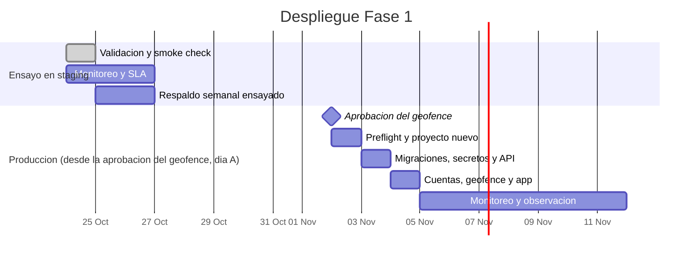

# Plan de migración del software (despliegue)

Estado: completo para la Fase 1 (2026-10-24). Guía de la tarea:
[`docs/deployment/BACKLOG.md`](docs/deployment/BACKLOG.md), D1.

Este plan describe cómo se lleva el sistema de un entorno a otro (local → staging →
producción): qué se migra, en qué orden, cómo se verifica cada paso y cómo se
revierte. Producción sigue bloqueada (fail-closed) hasta que la Asociación de
Hoteles de Chihuahua apruebe un geofence; por eso el procedimiento se ensaya sobre
staging, que es hoy el único proyecto real.

## 1. Entornos

Fuentes: `docs/DEPLOYMENT.md` (introducción y "Project bootstrap"), `eas.json`,
`README.md` ("Team setup").

| Entorno | Propósito | Proyecto / URL (sin secretos) | Quién opera | Datos |
|---|---|---|---|---|
| Local | Desarrollo y pruebas automatizadas de cada integrante. La app corre como build de desarrollo de Expo (perfil `development` de `eas.json`) y apunta a la API de staging; las suites de PostgreSQL usan contenedores Docker desechables (`npm run test:postgres`). | Máquina del integrante; sin proyecto Supabase propio (el stack local de Supabase es opcional). | Cada integrante | Solo datos de prueba creados por los tests; se destruyen al terminar. |
| Staging | Demostraciones, pruebas de sistema, alfa, carga y aceptación con el socio formador. Es el entorno donde se ensaya este plan. | Supabase managed Free `dcvihomkxkutkckmjvmp`; API `https://dcvihomkxkutkckmjvmp.supabase.co/functions/v1/api`; `deployment_metadata.environment = staging`. Build `preview` (APK interno) de EAS. | Operador técnico del equipo | Reportes de prueba y datos demo removibles (`docs/DEMO_DATA.md`); geofence **TEST ONLY** no aprobado. Sin datos personales. |
| Producción | Operación real para la Asociación de Hoteles de Chihuahua y el público. | **Aún no existe.** Será un segundo proyecto Supabase (Free o de pago) con `environment = production` y el build `production` de EAS. | Operador técnico, con aprobación de la Asociación | Arranca vacío: solo configuración, cuentas provisionadas y el geofence aprobado. |

## 2. Inventario de componentes a migrar

Fuentes: `supabase/migrations/`, `db/schema.sql`, `supabase/config.toml`,
`docs/SECURITY.md` ("Secret and fail-closed inventory"), `eas.json`.

| Componente | Origen en el repo | Cómo se migra | Verificación |
|---|---|---|---|
| Migraciones SQL (12, en orden: `20260908232749_initial_target_schema` … `20261021120000_add_photo_validation_thresholds`) | `supabase/migrations/` | `supabase db push --dry-run`, revisión, y luego `supabase db push`. Nunca se aplica `db/schema.sql` completo sobre una base existente. | La lista de migraciones remotas coincide con la carpeta (12/12); advisors de seguridad y rendimiento sin hallazgos nuevos. |
| Function `api` (Hono, un solo backend) | `supabase/functions/api/index.js` y `supabase/functions/api/deno.json` | `supabase functions deploy api --use-api` desde el commit aprobado. | Los archivos desplegados coinciden con el commit (SHA-256); `npm run smoke` en verde. |
| Secretos de la Function (solo nombres) | `supabase/functions/api/infrastructure/config.js` | `supabase secrets set` desde un archivo fuera de Git: `APP_BACKEND_DATABASE_URL`, `INTERNAL_RETENTION_SECRET`, `EXPECTED_SUPABASE_PROJECT_REF`, `EXPECTED_DEPLOYMENT_ENVIRONMENT`, `APPROVED_PHOTOS_BUCKET`; `JWT_SECRET` es opcional (respaldo de la verificación por JWKS). `SUPABASE_URL` y `SUPABASE_SERVICE_ROLE_KEY` los inyecta el proveedor. `ALLOW_REPORTS_WITHOUT_ACTIVE_GEOFENCE` **no** se define en producción. | `supabase secrets list` muestra los nombres (nunca valores); rutas de administración responden sin `503 preflight_mismatch`. |
| Bucket privado `approved-photos` y políticas | Migraciones de Storage en `supabase/migrations/` | Lo crean las migraciones; las políticas se verifican contra el esquema de Storage instalado. | `storage.buckets.public = false`. |
| Cuentas de Asociación y Administrator | `docs/SECURITY.md` ("Provisioning runbook") | Alta manual por el operador técnico en Auth + perfil con su rol. El registro público queda deshabilitado. | `POST /auth/v1/signup` responde `422 signup_disabled`; `GET /me` con cada cuenta devuelve su rol. |
| Metadata de entorno | `public.deployment_metadata` | Migración/registro con `environment = production` en el proyecto nuevo. | Coincide con el secreto `EXPECTED_DEPLOYMENT_ENVIRONMENT`. |
| Geofence aprobado | `docs/product/GEOFENCE-CANDIDATE.md` | Solo tras la aprobación escrita de la Asociación: `POST /admin/zone-sets` y `/activate` con la referencia de aprobación. Las coordenadas viven en la base, no en Git. | Sin zona activa la API rechaza reportes (fail-closed); con zona activa, puntos fuera se rechazan. |
| Build móvil y variables `EXPO_PUBLIC_*` | `eas.json` (perfiles `development`, `preview`, `production`) | `eas build --profile production` con `EXPO_PUBLIC_API_BASE_URL`, `EXPO_PUBLIC_SUPABASE_URL` y `EXPO_PUBLIC_SUPABASE_PUBLISHABLE_KEY` del proyecto de producción. | La app instalada abre el mapa y muestra la versión de configuración del servidor. |

## 3. Estrategia de migración

Fuentes: `docs/product/PROBLEM-CONTEXT.md`, `docs/DEPLOYMENT.md` ("Promotion and
verification").

Se usa una estrategia **big-bang sobre un proyecto nuevo**: el día del despliegue se
crea el proyecto de producción vacío, se le aplican las mismas migraciones y la misma
Function que ya pasaron en staging, y la app de producción empieza a usarlo de una
vez.

- **No hay sistema anterior del cual migrar datos.** Hoy la información sobre
  avistamientos e incidentes en Creel está dispersa y no existe una base de evidencia
  compartida (`docs/product/PROBLEM-CONTEXT.md`, "Current gap"); no hay una base de
  datos previa que convertir ni usuarios que trasladar.
- **No se copian datos de staging a producción.** Staging contiene reportes de
  prueba, datos demo y un geofence de prueba no aprobado; copiarlos mezclaría
  información falsa con la real y violaría la regla de no copiar datos vivos entre
  proyectos sin aprobación y desidentificación (`docs/DEPLOYMENT.md`).
- **Lo que sí se promueve es código y configuración versionada**: las migraciones
  con su orden y la Function `api` del mismo commit que se validó en staging.
- Una migración en paralelo (dos sistemas a la vez) no aplica porque no hay sistema
  viejo; una migración por fases no aporta porque es un solo backend y una sola app.

## 4. Procedimiento paso a paso

Fuentes: `docs/DEPLOYMENT.md` ("Required preflight and promotion", "Remote-first
workflow", "Post-deploy smoke check").

| # | Paso | Comando o acción | Verificación | Responsable |
|---|---|---|---|---|
| 1 | Congelar el commit a desplegar | Etiquetar en `main` el commit que pasó la CI y las pruebas de staging. | CI en verde (`npm test` y suites de PostgreSQL). | Operador técnico |
| 2 | Respaldo previo | Exportación completa según `docs/deployment/BACKUP-LOG.md` (si el destino ya tiene datos). | Checksums registrados. | Operador técnico |
| 3 | Preflight | `supabase --version`, `supabase projects list`, `supabase link --project-ref <ref>`; comparar ref, entorno esperado, cabeza de migraciones y nombres de secretos. | Cualquier diferencia **aborta** antes de cambiar algo. | Operador técnico |
| 4 | Crear y preparar el proyecto | Nuevo proyecto Supabase; deshabilitar signup y proveedores no usados; extensiones PostGIS y pgcrypto. | Advisors sin hallazgos críticos. | Operador técnico |
| 5 | Revisar migraciones | `supabase db push --dry-run` | Lista exactamente las 12 migraciones del repo, en orden. | Operador técnico + revisor |
| 6 | Aplicar migraciones | `supabase db push` | Lista remota = carpeta `supabase/migrations/`; RLS activo en las 13 tablas; `app_backend` `NOBYPASSRLS` sin objetos propios. | Operador técnico |
| 7 | Secretos | `supabase secrets set --env-file <archivo fuera de Git>` | `supabase secrets list` muestra los nombres requeridos. | Operador técnico |
| 8 | Desplegar la API | `supabase functions deploy api --use-api` | `npm run smoke` con `API_BASE_URL` del proyecto nuevo: todo OK. | Operador técnico |
| 9 | Cuentas y entorno | Provisionar cuentas de Asociación y Administrator; `deployment_metadata.environment = production`. | `GET /me` por rol; `GET /admin/configuration` sin `503 preflight_mismatch`. | Operador técnico |
| 10 | Geofence aprobado | `POST /admin/zone-sets` + `/activate` con la referencia de aprobación. | Reporte de prueba dentro de la zona aceptado y fuera rechazado. | Administrator + Asociación |
| 11 | App de producción | `eas build --profile production` con las variables `EXPO_PUBLIC_*` del proyecto nuevo. | Instalación en un teléfono Android e iPhone; mapa y envío funcionan. | Equipo de desarrollo |
| 12 | Monitoreo | Agregar los monitores de `docs/deployment/MONITORING.md` para el proyecto nuevo. | Primer chequeo en verde y alerta de prueba recibida. | Operador técnico |

## 5. Plan de reversión (rollback)

Fuentes: `docs/DEPLOYMENT.md` ("Milestone export and restore runbook"),
`docs/deployment/BACKUP-LOG.md`.

| Si falla… | Qué se hace | Cómo se confirma |
|---|---|---|
| El preflight (paso 3) | Nada que revertir: se aborta y se corrige la diferencia. | Preflight repetido sin diferencias. |
| Una migración (pasos 5–6) | En un proyecto nuevo y vacío: se descarta el proyecto y se repite. Con datos: restaurar la exportación previa en un proyecto aislado y apuntar la app a él (runbook de restauración). | Lista de migraciones y conteos iguales al respaldo. |
| La Function (paso 8) | Volver a desplegar la versión anterior: `git checkout <commit anterior>` y `supabase functions deploy api --use-api`. | `npm run smoke` en verde y archivos desplegados iguales al commit anterior. |
| Los secretos (paso 7) | Volver a definir los valores anteriores desde el almacén del operador; rotar si hubo exposición. | Rutas de administración responden sin `preflight_mismatch`. |
| El geofence (paso 10) | Activar el conjunto de zonas anterior (la activación reemplaza al activo de forma atómica y queda auditada). | `GET /admin/zone-sets` muestra el conjunto correcto activo. |
| La app (paso 11) | Distribuir de nuevo el build anterior (EAS conserva los builds). | La versión instalada coincide con la anterior. |

## 6. Criterios go/no-go y riesgos

**Go** solo si se cumplen todos:

- [ ] La Asociación de Hoteles de Chihuahua aprobó por escrito el geofence (versión y checksum).
- [ ] CI en verde sobre el commit etiquetado.
- [ ] Ensayo sobre staging del mismo commit registrado en la sección 8.
- [ ] Validación de infraestructura completa (`docs/deployment/INFRA-VALIDATION.md`).
- [ ] Respaldo previo registrado (`docs/deployment/BACKUP-LOG.md`).
- [ ] Monitores listos y alertas probadas (`docs/deployment/MONITORING.md`).
- [ ] Cuentas de personal provisionadas y entregadas por canal seguro.

| Riesgo | Impacto | Mitigación |
|---|---|---|
| Geofence sin aprobar | Producción no acepta reportes (fail-closed). | Es bloqueante: no hay despliegue hasta la aprobación. |
| Cuotas del plan Free (500 MB BD, 1 GB Storage, 5 GB egress, 500k invocaciones) | Servicio degradado al llegar al límite. | Monitoreo de Usage con umbral al 80 %; hoy staging usa 21 MB de BD, 10 MB de Storage y ≈ 5.9k invocaciones/día. |
| Pausa por inactividad del plan Free | API inaccesible hasta reactivar el proyecto. | El monitor externo llama cada 5 min, lo que mantiene actividad y alerta si se pausa. |
| Sin respaldos automáticos en Free | Pérdida de datos ante un error. | Exportación semanal manual (`docs/deployment/BACKUP-LOG.md`). |
| Peticiones colgadas bajo concurrencia (INC-4, `docs/deployment/INFRA-VALIDATION.md`) | Algunas lecturas que tocan la base no responden. | Corregido (PR #91, 0 % de errores con 25 usuarios en staging); el commit desplegado a producción debe incluirlo. |
| Cuentas de tiendas (Apple/Google) | No se puede publicar en tiendas. | Fuera de alcance de la Fase 1: distribución interna por enlace (APK `preview`). |

## 7. Cronograma

Formato de referencia: `docs/testing/PLAN.md` (Gantt `mermaid`). Las fechas de
producción dependen de la aprobación del geofence; se muestran como relativas a esa
fecha (día A).

La fecha del hito "Aprobación del geofence" es ilustrativa: depende de la Asociación.
**Ventana de despliegue:** un día hábil, entre semana, de 9:00 a 13:00 (hora de
Chihuahua), con el operador técnico y un revisor presentes y sin demostraciones
agendadas ese día.

## 8. Ensayo sobre staging

Ensayo del 2026-10-24 sobre staging (`dcvihomkxkutkckmjvmp`), commit `32a4183`
(`main`). Los primeros pasos se verificaron por la API de administración de Supabase
(servidor MCP); después se repitieron con la CLI de Supabase 2.122.0 (`npx supabase`).

| Fecha | Operador | Versión de Supabase CLI | Commit desplegado | Paso | Resultado |
|---|---|---|---|---|---|
| 2026-10-24 07:48 UTC | Operador técnico (asistido) | sin CLI en la VPS; API de administración | `32a4183` | 5–6 Migraciones: lista remota contra `supabase/migrations/` (equivale a un `db push --dry-run` sin pendientes) | **Pasó.** 12/12 migraciones aplicadas, cabeza `20261021120000`; nada pendiente. |
| 2026-10-24 07:49 UTC | Operador técnico (asistido) | sin CLI | `32a4183` | 6 Estado de la base (RLS, `app_backend`, grants, bucket, extensiones) | **Pasó.** Ver checklist en `docs/deployment/INFRA-VALIDATION.md`. |
| 2026-10-24 07:52 UTC | Operador técnico (asistido) | sin CLI | `32a4183` | 8 Function `api` desplegada = commit | **Pasó.** Versión 116 ACTIVE; 83/83 archivos desplegados idénticos (SHA-256) a `supabase/functions/api/` en `32a4183`. |
| 2026-10-24 07:50 UTC | Operador técnico (asistido) | sin CLI | `32a4183` | 8 `npm run smoke` (3 corridas) | **Pasó.** Ver registro en `docs/deployment/INFRA-VALIDATION.md`. |
| 2026-10-24 08:23 UTC | Operador técnico (asistido) | 2.122.0 | `0fb3f76` (corrección de INC-4, PR #91) | 8 `supabase functions deploy api --use-api` | **Pasó.** "Deployed Functions."; smoke check OK; k6 0 % de errores con 2 a 25 usuarios. Reversión probada como procedimiento: volver a desplegar `main`. |
| 2026-10-24 08:30 UTC | Operador técnico (asistido) | 2.122.0 | — | 3 y 5 `supabase link --project-ref dcvihomkxkutkckmjvmp` y `supabase db push --dry-run` | **Pasó.** "Remote database is up to date."; ninguna migración pendiente. |
