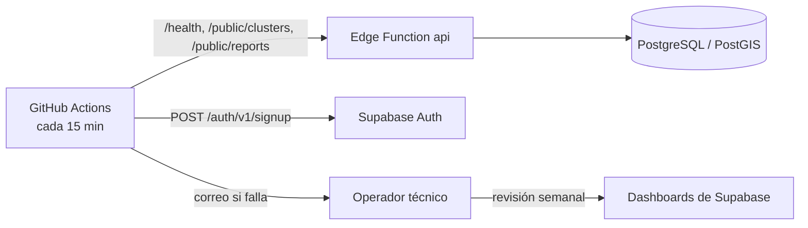

# Monitoreo de infraestructura

Estado: monitoreo automático **activo** sobre staging desde el 2026-10-24 (monitor
programado en GitHub Actions cada 15 minutos, sección 2). Faltan las capturas de los
dashboards; UptimeRobot y el servicio Python en Render son extensiones opcionales
(marcadas "opcional" abajo). Guía de la tarea:
[`docs/deployment/BACKLOG.md`](docs/deployment/BACKLOG.md), D3. Cubre RNF25.

Capturas en `docs/deployment/img/`, sin claves, correos ni IDs sensibles.

Monitorear es observar el sistema mientras opera para saber, sin esperar a que un
usuario se queje, si está arriba, qué tan rápido responde y cuánto de sus recursos
gratuitos consume. Se usan cuatro mecanismos complementarios:

| Mecanismo | Pregunta que responde | Quién avisa |
|---|---|---|
| Dashboards de Supabase | ¿Cuánto se usa y dónde están los errores? | Revisión del operador (Free no envía alertas de uso) |
| Monitor programado (GitHub Actions, **activo**) | ¿Está arriba ahora mismo y responde a tiempo? | Correo automático de GitHub cuando una corrida falla |
| Script de humo (`npm run smoke`) | ¿Quedó bien el despliegue que acabo de hacer? | El operador, al ejecutarlo |
| Monitor sintético en Python (opcional) | ¿Responden todas las piezas y a tiempo, en un solo JSON? | UptimeRobot, al recibir un `503` |
| UptimeRobot (opcional) | Segunda vigilancia externa cada 5 min | Correo automático a los responsables |



## 1. Dashboards de Supabase

Fuentes: `docs/DEPLOYMENT.md` ("Managed Free planning assumptions", "Retention and
monitoring").

Se consultan en `https://supabase.com/dashboard/project/dcvihomkxkutkckmjvmp`. Los
valores de la columna "Hoy" se leyeron el 2026-10-24 por la API de administración
(logs y consultas de solo lectura).

| Dashboard | Qué muestra | Hoy (staging) | Umbral de alerta | Acción | Captura |
|---|---|---|---|---|---|
| Usage (BD, Storage, egress, invocaciones) | Consumo del mes frente a la cuota Free: 500 MB de BD, 1 GB de Storage, 5 GB de egress, 500k invocaciones. | BD 21 MB (4 %); Storage 10 MB en 18 objetos (1 %); ≈ 5.9k invocaciones en 24 h (≈ 177k/mes proyectadas, 35 %). | 80 % de cualquier cuota. | Revisar qué lo provoca (carga de prueba, bucle de la app), borrar datos de prueba, o plan de pago. | Pendiente |
| Edge Functions → `api` | Invocaciones, errores por código, tiempo de ejecución y logs de cada petición. | 5,909 invocaciones en 24 h; 3 respuestas `5xx` (0.05 %); tiempo de ejecución p50 515 ms, p95 1,095 ms. | `5xx` > 1 % en una hora, o p95 > 3,000 ms. | Abrir los logs filtrando por código; ver la sección 6. | Pendiente |
| Database (Query Performance, conexiones) | Consultas más lentas y más frecuentes, conexiones abiertas. | 12 conexiones de 60. | Conexiones > 48 (80 %) o una consulta frecuente > 1 s. | Revisar la consulta en Query Performance; índices; INC-4. | Pendiente |
| Auth | Inicios de sesión correctos y fallidos del personal. | Signup deshabilitado (`422`); 4 cuentas de personal (3 Administrator, 1 Asociación). | Más de 10 fallos seguidos de una cuenta, o un usuario nuevo inesperado. | Bloquear la cuenta y rotar su contraseña (`docs/DEPLOYMENT.md`, "Incident priorities"). | Pendiente |
| Advisors (Security / Performance) | Configuración insegura o lenta detectada por Supabase. | 1 WARN aceptado (protección de contraseñas filtradas, solo Pro); 13 INFO aceptados. | Cualquier hallazgo nuevo de nivel WARN o ERROR. | Corregir con una migración y volver a correr los advisors. | Pendiente |

**Capturas pendientes:** se toman con la cuenta del equipo en el dashboard (la VPS no
tiene sesión), tapando claves y correos, y se guardan en `docs/deployment/img/` en
PNG con los nombres `01-usage`, `02-edge-functions`, `03-query-performance`,
`04-auth` y `05-advisors`.

## 2. Monitor programado (GitHub Actions)

El workflow `.github/workflows/staging-monitor.yml` corre `scripts/smoke.mjs`
contra staging **cada 15 minutos** desde el 2026-10-24. También se puede lanzar a
mano (Actions → Staging monitor → Run workflow). Corre en la infraestructura de
GitHub, fuera de Supabase, así que avisa aunque el proyecto completo esté caído o
pausado.

| Chequeo | Condición de "arriba" |
|---|---|
| `GET /health` | `200` y `data.database == "up"` (la API llega a la base) |
| `GET /public/clusters` | `200` con una lista |
| `GET /public/reports` | `200` con una lista |
| `POST /auth/v1/signup` | `422 signup_disabled` (el registro público sigue bloqueado) |

- **Alerta:** si un chequeo falla, la corrida termina en rojo y GitHub envía un correo
  de "workflow run failed" a la cuenta que creó el workflow; el historial de corridas
  es el registro de disponibilidad.
- **Evidencia por corrida:** el resumen de cada corrida guarda la latencia de cada
  chequeo.
- **Llave:** solo la llave publicable, en el secreto del repositorio
  `STAGING_SUPABASE_PUBLISHABLE_KEY`; ningún secreto del servidor.
- **Consumo de cuota:** 3 invocaciones de la Function por corrida ≈ 8.6k/mes (2 % de
  la cuota Free); además mantiene el proyecto activo, lo que evita la pausa por
  inactividad.
- **Límites conocidos:** GitHub puede retrasar unos minutos las corridas programadas
  en horas de carga, y desactiva los workflows programados de un repositorio público
  tras 60 días sin actividad (se reactiva con un clic).
- **Apagarlo:** Actions → Staging monitor → Disable workflow.

**Primera corrida (2026-10-24 16:33 UTC):**
[run 40112072316](https://github.com/CardozoPapaDelAme/dog_report_app/actions/runs/40112072316),
resultado correcto:

```text
OK       GET /health            200  1048 ms
OK       GET /public/clusters   200  1137 ms
OK       GET /public/reports    200  967 ms
OK       POST /auth/v1/signup   422  304 ms
Resultado: OK
```

### Extensión opcional: UptimeRobot

Si el equipo quiere una segunda vigilancia cada 5 minutos con página de estado
pública, UptimeRobot (plan gratuito) puede vigilar
`https://dcvihomkxkutkckmjvmp.supabase.co/functions/v1/api/health` (tipo Keyword,
palabra `"up"`) y el monitor Python de la sección 3. No está dado de alta.

## 3. Health check en Python

Fuentes: `examples/python_health/README.md`, `examples/python_health/app.py`,
`examples/python_health/test_health.py`.

Es un servicio pequeño (FastAPI) que actúa como un usuario sintético: revisa tres
endpoints, mide cuánto tarda cada uno y responde un solo JSON con el estado de cada
componente. Si alguno falla responde `503`, de modo que UptimeRobot lo ve como caído.

| Componente | Petición | Sano cuando |
|---|---|---|
| `api_database` | `GET /health` | `200` y `database: up` |
| `public_clusters` | `GET /public/clusters?zoom=10&limit=5` | `200` con una lista |
| `public_reports` | `GET /public/reports?limit=5` | `200` con una lista |

- Estados por componente: `up`, `slow` (respondió pero tardó más que
  `LATENCY_THRESHOLD_MS`, 3,000 ms por defecto, el objetivo del SLA) o `down`.
- Estado general: `up` → `200`; `degraded` (alguno lento) → `200`; `down` → `503`.
- Configuración por variables `API_BASE_URL`, `TIMEOUT_SECONDS` y
  `LATENCY_THRESHOLD_MS`; versiones fijas en `examples/python_health/requirements.txt`;
  no necesita secretos.
- Pruebas: 7 con `pytest` (sano, base caída, `200` sin base, red caída, tiempo
  límite, degradado por latencia, configuración); pasaron el 2026-10-24.

Respuesta real contra staging (2026-10-24 07:56 UTC):

```json
{"status": "up", "checked_at": "2026-10-24T07:56:34+00:00", "latency_threshold_ms": 3000,
 "components": {"api_database": {"status": "up", "http_status": 200, "latency_ms": 894, "error": null},
                "public_clusters": {"status": "up", "http_status": 200, "latency_ms": 504, "error": null},
                "public_reports": {"status": "up", "http_status": 200, "latency_ms": 510, "error": null}}}
```

**Despliegue:** en un servicio web gratuito (Render): raíz
`examples/python_health`, build: instalar con pip
`examples/python_health/requirements.txt`, arranque
`uvicorn app:app --host 0.0.0.0 --port $PORT`. Opcional: no está desplegado; el monitor programado de la sección 2 ya
cubre los mismos chequeos.

## 4. Qué se monitorea (RNF25)

| Señal | Herramienta | Frecuencia | Umbral | Responsable |
|---|---|---|---|---|
| Cuotas Free | Dashboard Usage | Semanal (manual) | 80 % de cualquier cuota | Operador técnico |
| Errores de la API | Monitor programado (GitHub Actions); dashboard Edge Functions | Cada 15 min (automático) / semanal | Un chequeo fallido; `5xx` > 1 % por hora | Operador técnico |
| Latencia | Monitor programado (latencia por chequeo); `npm run smoke` tras cada despliegue | Cada 15 min | > 3,000 ms (estado `slow`) | Operador técnico |
| Conexiones a PostgreSQL | Dashboard Database | Semanal (manual) | > 48 de 60 | Operador técnico |
| Pausa del proyecto | Monitor programado (deja de responder) | Cada 15 min | Cualquier caída > 10 min | Operador técnico |
| Retención y scheduler | Logs de `POST /internal/retention/run` | Semanal (manual) | Sin corrida exitosa en 7 días | Operador técnico |
| Antigüedad de la última exportación | `docs/deployment/BACKUP-LOG.md` | Semanal (manual) | > 7 días | Operador técnico |
| Volumen de auditoría | Consulta de conteo sobre `audit_log` | Semanal (manual) | Pico inesperado de acciones de administración | Administrator |

Estado al 2026-10-24: el job de retención **no tiene scheduler** en staging (no hay
`pg_cron` ni un programador externo); se registra como revisión manual hasta que se
apruebe uno, como exige `docs/DEPLOYMENT.md`. El plan Free no ofrece alertas de uso
automáticas, por eso las señales marcadas "manual" van en la revisión semanal.

## 5. Procedimiento de alerta

Fuentes: `docs/DEPLOYMENT.md` ("Incident priorities"), `docs/deployment/SLA.md`.

1. **Recepción:** GitHub envía el correo de la corrida fallida del monitor programado.
2. **Confirmación (≤ 1 h en horario hábil):** el operador corre `npm run smoke` y
   abre el resumen de la corrida fallida para ver qué chequeo falla.
3. **Clasificación:** se asigna severidad con la tabla de `docs/testing/INCIDENTS.md`
   y se abre el incidente con su plantilla.
4. **Escalamiento:** si en 4 h no hay diagnóstico, se avisa al resto del equipo de
   desarrollo; si afecta datos o seguridad, se aplican primero las prioridades de
   `docs/DEPLOYMENT.md` (rotar secretos, preservar evidencia).
5. **Cierre:** la solución se verifica con una nueva corrida y se cumple el tiempo
   de respuesta de 24 h del SLA (`docs/deployment/SLA.md`, sección 6).

## 6. Diagnóstico y solución de problemas

| Síntoma | Cómo se identifica | Causa probable | Solución |
|---|---|---|---|
| Todo caído; el monitor programado en rojo en sus cuatro chequeos | `npm run smoke` falla en las cuatro llamadas | Proyecto pausado por inactividad o incidente del proveedor | Reactivar el proyecto en el dashboard; revisar `https://status.supabase.com`. |
| `/health` responde `503 database_unavailable` | Componente `api_database` en `down` | Base no disponible o conexión rechazada | Revisar Database → conexiones; revisar el secreto `APP_BACKEND_DATABASE_URL`; reintentar. |
| Peticiones sin respuesta hasta el tiempo límite | Monitor Python con `ReadTimeout` | Una operación de base excedió 10 s (desde la corrección de INC-4 la API responde `503` y reconecta sola) | Reintentar; si se repite, revisar consultas lentas en Query Performance y el estado de Supavisor. |
| Rutas de administración responden `503 preflight_mismatch` | La app del Administrator no carga configuración | `EXPECTED_DEPLOYMENT_ENVIRONMENT` ausente o distinto de `deployment_metadata.environment` | Corregir el secreto con `supabase secrets set` y verificar. |
| Los reportes se rechazan por zona | La app avisa "fuera de zona" dentro de Creel | Sin conjunto de zonas activo o geofence incorrecto | Revisar Zonas en el panel del Administrator; activar el conjunto correcto. |
| Latencia alta (`slow`) sostenida | `latency_ms` > 3,000 en el monitor | Arranque en frío, consulta lenta o cuota cerca del límite | Query Performance y Usage; índices; reducir datos de prueba. |
| Uso cerca de la cuota | Dashboard Usage ≥ 80 % | Carga de prueba o crecimiento real | Limpiar datos demo (`docs/DEMO_DATA.md`) o pasar a plan de pago. |
