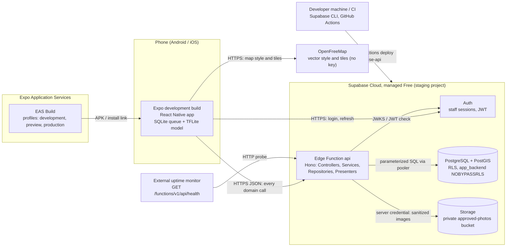

# Deployment Diagram

Managed deployment boundary for Phase 1. The Supabase decomposition is logical
(Auth, one Edge Function `api`, Storage, PostgreSQL/PostGIS); it does not claim
physical provider internals. Sources: `docs/architecture/OVERVIEW.md`,
`docs/INTEGRATIONS.md`, `docs/DEPLOYMENT.md`, `eas.json`.

Notes:

- The mobile app never reaches PostgreSQL or Storage directly; it only holds the
  publishable client configuration (`EXPO_PUBLIC_*`).
- Production does not exist yet: it stays blocked (fail-closed) until the
  Asociación de Hoteles de Chihuahua approves a geofence version.
