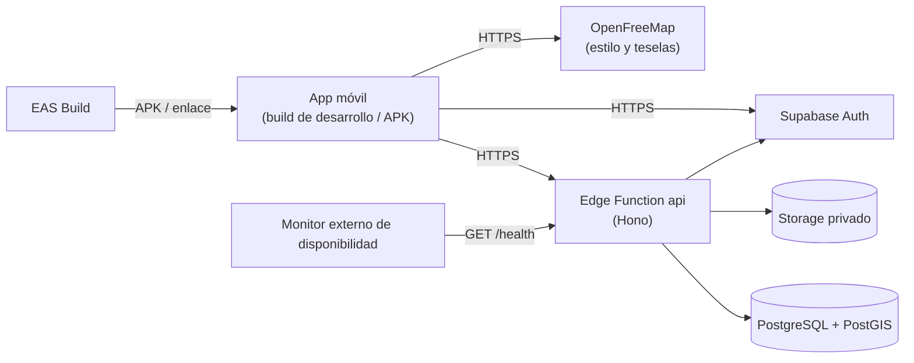

# Manual técnico

Guía completa de la tarea:
[`docs/deployment/BACKLOG.md`](/docs/deployment/BACKLOG.md), D8.

Audiencias: desarrollador, administrador técnico (sysadmin), mantenimiento,
soporte y operación.

## 1. Introducción

Este manual describe cómo está construido, desplegado, probado y vigilado el
sistema de reportes de perros callejeros de Creel, Chihuahua: una sola app móvil
(React Native con Expo) para tres actores —el **reportero público anónimo**, la
**Asociación de Hoteles de Chihuahua** y el **Administrador**— y un back end
administrado en Supabase. Resume y enlaza los documentos fuente del repositorio;
cuando un tema tiene un documento dueño, aquí solo se da lo necesario para
orientarse y se enlaza el detalle.

| Audiencia | Qué necesita | Secciones |
|---|---|---|
| Desarrollador | Arquitectura, librerías y versiones, estructura del código, cómo correr pruebas | 3, 4, 5, 8, Anexo |
| Administrador técnico (sysadmin) | Infraestructura, entornos, despliegue, secretos (por nombre) | 3, 4.4, 6, 7 |
| Mantenimiento | Versiones exactas, CI, migraciones, pruebas de regresión | 4, 5, 8 |
| Soporte | Instalación, problemas comunes, monitoreo, a quién avisar | 6, 7, 9 |
| Operación | Monitoreo, alertas, límites del plan, contacto | 3.2, 4.4, 7, 9 |

Términos usados: **Edge Function** (función de servidor que Supabase ejecuta bajo
demanda), **RLS** (Row Level Security: reglas de PostgreSQL que limitan qué filas
puede ver o cambiar cada rol), **PostGIS** (extensión geográfica de PostgreSQL),
**EAS** (servicio de Expo que compila la app en la nube), **geofence** (polígono
dentro del cual se aceptan reportes), **staging** (entorno de pruebas y demo).

## 2. Alcance

Fuentes: `docs/product/ROADMAP.md`, `docs/product/APPROVED-CLARIFICATIONS.md`.

**Cubre (Fase 1, prototipo):**

- Reporte anónimo con foto opcional, validación de la foto en el teléfono
  (MobileNetV3-Small con TFLite), cola local sin conexión y sincronización.
- Mapa público con grupos (clusters) y posiciones aproximadas a 50 m, lista de
  reportes de una zona y denuncia de reportes.
- Inicio de sesión del personal (cuentas creadas a mano; el registro público está
  deshabilitado).
- Panel de la Asociación con exportación CSV/XLSX de los datos de negocio aceptados.
- Command Center del Administrador: moderación, umbrales, conjuntos de zonas
  (geofence) y duplicados, todo auditado.
- Despliegue sobre Supabase managed Free (proyecto de staging), monitoreo,
  respaldos ensayados y pruebas automatizadas.

**No cubre:**

- **Producción sin geofence aprobado:** la recepción de reportes en vivo queda
  bloqueada (fail-closed) hasta que la Asociación de Hoteles de Chihuahua apruebe
  una versión de geofence (`docs/product/GEOFENCE-CANDIDATE.md`).
- **Publicación en tiendas** (App Store / Google Play): el perfil `production` de
  `eas.json` existe pero no se usa.
- **Embeddings / similitud visual de duplicados:** es una Fase 2 opcional
  (ADR-017 en `docs/architecture/DECISIONS.md`); la Fase 1 usa reglas de tiempo,
  distancia y revisión humana.
- SLA de 99.9 %, alta disponibilidad, PITR (recuperación a un punto en el tiempo),
  dominio propio, cuentas por hotel, notificaciones push e integración directa con
  autoridades (`docs/product/ROADMAP.md`, "Deferred").

## 3. Infraestructura

Fuentes: `docs/architecture/OVERVIEW.md`, `docs/INTEGRATIONS.md`,
`docs/DEPLOYMENT.md`.

### 3.1 Diagrama de despliegue

Diagrama completo (Mermaid): [`docs/diagrams/deployment.md`](/docs/diagrams/deployment.md).

Puntos clave:

- **Un solo proveedor administrado:** Supabase Cloud, plan Free. Se descompone de
  forma lógica en Auth (sesiones), la Edge Function `api`, Storage (fotos
  sanitizadas, privadas) y PostgreSQL/PostGIS. No se afirma nada de su topología
  física interna.
- **Un solo back end:** toda operación de dominio pasa por la Function `api`, una
  API Hono en JavaScript organizada en Controllers, Services, Repositories, Domain
  y Presenters (`supabase/functions/api/`). Los Repositories usan SQL
  parametrizado directo con el login `app_backend` (`NOBYPASSRLS`, mínimo
  privilegio); la app nunca toca tablas de dominio ni PostgREST.
- **La app solo recibe configuración publicable** (`EXPO_PUBLIC_*`); ningún
  secreto del servidor viaja al teléfono.
- **Servicios externos:** EAS (compilación e instalación por enlace), OpenFreeMap
  (mapa interino sin llave; MapTiler es el objetivo, `docs/INTEGRATIONS.md`) y un
  GitHub Actions, que corre el monitor programado de disponibilidad cada 15 minutos
  (`docs/deployment/MONITORING.md`).

### 3.2 Entornos

| Entorno | Qué es | Estado |
|---|---|---|
| Local | Máquina del desarrollador: Metro, build de desarrollo, pruebas (`npm test`) y suites PostgreSQL en contenedores Docker desechables. El stack local de Supabase es opcional | Disponible |
| Staging | Proyecto Supabase Free `dcvihomkxkutkckmjvmp`. API desplegada, cuentas de prueba, geofence **TEST ONLY** (Creel candidato INEGI + Chihuahua, Delicias y Meoqui) y datos demo opcionales | Activo |
| Producción | Proyecto en vivo con `deployment_metadata.environment = production` | No creado. Bloqueado hasta que la Asociación de Hoteles de Chihuahua apruebe un geofence |

El geofence de prueba nunca se activa en producción (`docs/DEPLOYMENT.md`,
"Current staging test geofence"). El plan de migración a producción está en
`docs/deployment/MIGRATION-PLAN.md`.

## 4. Requerimientos técnicos

Fuentes: `docs/STACK.md`, `package.json`, `package-lock.json`,
`supabase/functions/api/deno.json`, `.github/workflows/tests.yml`,
`examples/python_health/requirements.txt`.

Versiones verificadas el 2026-10-24 contra los archivos del repositorio. "Instalada"
es la versión resuelta en `package-lock.json` o en `supabase/functions/api/deno.lock`.

### 4.1 Librerías y versiones

App móvil (`package.json`):

| Librería | Versión | Para qué |
|---|---|---|
| `expo` | 57.0.28 (`~57.0.28`) | SDK de Expo: módulos nativos y herramientas de build |
| `react-native` | 0.86.3 | Runtime móvil nativo iOS/Android |
| `react` | 19.2.3 | Biblioteca de interfaz |
| `expo-dev-client` | 57.0.20 | Build de desarrollo (cliente que carga código desde Metro) |
| `@maplibre/maplibre-react-native` | 11.4.1 (`^11.4.1`) | Mapa vectorial nativo |
| `react-native-fast-tflite` | 3.0.1 (`^3.0.1`) | Inferencia TFLite en el teléfono (validación de foto) |
| `react-native-nitro-modules` | 0.37.1 | Dependencia nativa de `react-native-fast-tflite` |
| `i18next` | 26.4.2 (`^26.4.2`) | Traducciones |
| `react-i18next` | 17.0.13 (`^17.0.13`) | Integración de i18next con React |
| `expo-sqlite` | 57.0.4 | Cola local de borradores y estado sin conexión |
| `expo-camera` | 57.0.6 | Cámara |
| `expo-location` | 57.0.21 | GPS del reporte |
| `expo-secure-store` | 57.0.4 (`~57.0.3`) | Guardado seguro de la sesión |
| `expo-image-manipulator` | 57.0.21 | Redimensionar y normalizar la foto |
| `expo-network` | 57.0.2 | Estado de la conexión |
| `expo-build-properties` | `~57.0.22` | Propiedades nativas (soporte UIScene en iOS) |
| `@supabase/supabase-js` | 2.117.2 (`^2.117.2`) | Cliente de Supabase Auth (solo sesiones) |
| `jpeg-js` | 0.4.4 | Decodificación JPEG en JavaScript (color detectado) |
| `xlsx` (SheetJS) | 0.20.3 (tarball de cdn.sheetjs.com) | Exportación XLSX |
| `lucide-react-native` | 1.56.0 | Íconos |
| `react-native-svg` | 15.15.4 | Dibujo vectorial |
| `react-native-web` | 0.21.2 | Render web para las pruebas de UI |
| `jail-monkey` | 3.0.0 | Detección de ubicación simulada (el reporte va a moderación) |

Back end, Edge Function `api` (`supabase/functions/api/deno.json`):

| Librería | Declarada | Instalada | Para qué |
|---|---|---|---|
| Hono (`jsr:@hono/hono`) | `^4` | 4.13.8 | Framework HTTP de la API |
| `postgres` (npm) | `^3` | 3.4.9 | Cliente PostgreSQL con SQL parametrizado vía pooler |
| `jose` (npm) | `^5` | 5.10.0 | Verificación de JWT contra el JWKS del proyecto |
| `jimp-compact` (npm) | 0.16.1 | 0.16.1 | Decodificar y recodificar imágenes (sanitización) |
| `jpeg-js` (npm) | 0.4.4 | sin registro en `supabase/functions/api/deno.lock` | Decodificación JPEG |

`package.json` también declara `hono` (instalada 4.13.8), `postgres` (3.4.9) y
`jose` (6.2.12); la app móvil no los importa (solo el código del back end y
sus pruebas).

Pruebas y monitor:

| Herramienta | Versión | Para qué |
|---|---|---|
| `@playwright/test` | 1.63.0 | Pruebas de interfaz (navegador Chromium) |
| `esbuild` | 0.28.2 | Empaquetar la app para las pruebas de interfaz |
| k6 | v2.3.0 (registrada en `docs/testing/TEST_LOG.md`) | Prueba de carga de lectura (`tests/load/public-read.js`) |
| Imagen `postgis/postgis` | 17-3.5 | Suites PostgreSQL en Docker (`docs/TESTING.md`) |
| fastapi, uvicorn, pytest, httpx | Sin versión fijada en `examples/python_health/requirements.txt` | Monitor sintético de salud en Python |

### 4.2 Lenguajes y runtimes

| Lenguaje / runtime | Versión | Dónde |
|---|---|---|
| JavaScript (sin TypeScript) | — | App móvil, API `api`, scripts y pruebas |
| SQL (PostgreSQL) | PostgreSQL 17 (`supabase/config.toml`, `major_version`) | Migraciones en `supabase/migrations/` y modelo `db/schema.sql` |
| Python | 3, sin versión fijada | Monitor de salud `examples/python_health/` |
| Node | Mínimo 20 (`scripts/doctor.mjs`); CI usa 22; corridas registradas con v24.20.0 | Herramientas, Metro, `node:test` |
| Deno | CI usa `v2.x`; corridas registradas con 2.9.6 | Pruebas Deno y runtime de la Edge Function |
| Java (JDK) | 17 o superior | Compilación Android |

### 4.3 Sistemas operativos

| Uso | Sistema | Fuente |
|---|---|---|
| Teléfono Android | Android 7.0 o superior (API 24, `minSdk` de React Native 0.86.3) | `node_modules/react-native/gradle/libs.versions.toml` |
| Teléfono iPhone | iOS 16.4 o superior (mínimo de Expo Modules en el SDK 57) | `node_modules/expo-modules-core/ExpoModulesCore.podspec` |
| Desarrollo Android | Windows, macOS o Linux con Android Studio | `README.md` |
| Desarrollo iOS | Solo macOS con Xcode 16.1 o superior | `README.md`, `node_modules/react-native/scripts/cocoapods/helpers.rb` |
| CI | Ubuntu (`ubuntu-latest`) | `.github/workflows/tests.yml` |

Los mínimos de teléfono vienen del toolchain instalado; las pruebas en dispositivo
del equipo se hicieron en Android real (`docs/testing/ALPHA.md`).

### 4.4 Nube

| Servicio | Plan / uso | Límites y notas |
|---|---|---|
| Supabase Cloud | Free; proyecto staging `dcvihomkxkutkckmjvmp`. Región: sin registrar en el repositorio | Hasta 2 proyectos activos; BD 500 MB; Storage 1 GB; egress 5 GB; 500,000 invocaciones de Functions; sin respaldos automáticos; el proyecto puede pausarse por inactividad (`docs/DEPLOYMENT.md`, verificado para planeación el 2026-09-05) |
| EAS (Expo) | Builds en la nube con perfiles `development`, `preview`, `production` (`eas.json`, CLI 16.0.0 o superior) | Distribución interna por enlace; iOS requiere cuenta de Apple Developer |
| OpenFreeMap | Estilo `liberty` sin llave (interino) | Atribución "© OpenMapTiles © OpenStreetMap contributors" visible; se cambia a MapTiler con `EXPO_PUBLIC_MAP_STYLE_URL` |
| Monitor externo de disponibilidad | Sondeo HTTP de `GET /functions/v1/api/health` | Configuración en `docs/deployment/MONITORING.md` |
| GitHub Actions | CI en cada PR y en `main` | Sin secretos, permisos de solo lectura |

Secretos de la Function: solo por nombre, en `docs/manuals/INSTALLATION.md`
(sección 3.2) y `docs/SECURITY.md` ("Secret and fail-closed inventory").

## 5. Repositorios de código

**URL:** https://github.com/CardozoPapaDelAme/dog_report_app (un solo repositorio
para app, back end, base de datos, pruebas y documentación).

**Estructura de carpetas:**

| Carpeta | Contenido |
|---|---|
| `screens/`, `components/`, `navigation/`, `theme/`, `assets/` | Pantallas, componentes de interfaz, tokens de diseño e imágenes de la app |
| `controllers/`, `presenters/`, `models/`, `hooks/` | Lógica de presentación y modelos del cliente |
| `services/`, `dao/` | Cliente HTTP de la API, sesión, exportación y acceso a SQLite |
| `i18n/` | Traducciones |
| `supabase/functions/api/` | Back end Hono: `routes/`, `controllers/`, `services/`, `repositories/`, `domain/`, `presenters/`, `middleware/`, `infrastructure/` |
| `supabase/migrations/` | Migraciones SQL ordenadas |
| `db/` | Modelo objetivo `db/schema.sql` |
| `scripts/` | Setup, doctor, lanzador de la app, corredores de pruebas, datos demo |
| `tests/` | Pruebas de interfaz (`tests/ui/`) y de carga (`tests/load/`) |
| `examples/python_health/` | Monitor de salud en Python (no forma parte del back end) |
| `docs/` | Documentación (índice en `docs/README.md`) |
| `promo-video/` | Material del video promocional |

Las pruebas unitarias viven junto al código (`*.test.js`).

**Ramas:** `main` es la rama principal e integra todo por pull request. Las ramas
de trabajo usan la clave de Jira, `TD-<n>-<descripción>` (por ejemplo
`TD-129-inc-1-el-servicio-de-moderacion-no-autoriza-el-rol-del-actor`), o un
prefijo de tipo (`feat/`, `fix/`, `docs/`, `test/`).

**Pull requests:** cada cambio entra a `main` por un PR revisado en GitHub (el más
reciente fusionado al escribir este manual es el #89). Los mensajes de commit
siguen Conventional Commits (`feat:`, `fix:`, `docs:`, `test:`). Los PRs que
agregan o actualizan una librería nativa avisan "requires rebuild".

**CI** (`.github/workflows/tests.yml`): corre en cada PR y en cada push a `main`,
sin secretos y con permisos de solo lectura. Dos trabajos en paralelo:

- `npm test`: Node 22, Deno `v2.x`, `npm ci`, instala Chromium de Playwright y
  ejecuta `npm test`; sube el reporte HTML de Playwright como artefacto (14 días).
- `PostgreSQL suites`: Node 22, Deno `v2.x` y `node scripts/test-postgres.mjs`
  con contenedores PostGIS desechables.

## 6. Instalación

Ver `docs/manuals/INSTALLATION.md`.

Resumen:

1. **App móvil:** `npm run setup` (crea `.env` con la configuración pública de
   staging e instala dependencias), `npm run doctor` (diagnóstico de la máquina) y
   `npm run app:android` / `npm run app:ios` (compila e instala la build de
   desarrollo). Para revisores, APK `preview` de EAS instalado por enlace.
2. **Back end:** `npx supabase login`, `npx supabase link --project-ref <ref>`,
   secretos de la Function (solo nombres en el manual),
   `npx supabase functions deploy api --use-api` y smoke check.
3. **Base de datos:** proyecto nuevo, extensiones PostGIS y pgcrypto,
   `npx supabase db push --dry-run` y `npx supabase db push`, bucket privado,
   cuentas del personal, metadata de entorno, geofence de prueba y datos demo
   opcionales (`docs/DEMO_DATA.md`).

## 7. Monitoreo

Ver `docs/deployment/MONITORING.md`.

Resumen de mecanismos:

| Mecanismo | Qué vigila |
|---|---|
| Dashboards de Supabase | Usage (BD, Storage, egress, invocaciones contra las cuotas Free), logs de la Edge Function `api`, Query Performance y conexiones de PostgreSQL, advisors de seguridad y rendimiento |
| Monitor HTTP externo de disponibilidad | Sondea `GET /functions/v1/api/health` y avisa si la API deja de responder o el proyecto se pausa |
| Monitor sintético en Python (`examples/python_health/`) | Servicio FastAPI cuyo `GET /health` revisa `/health`, `/public/clusters` y `/public/reports`, mide la latencia de cada uno contra el umbral del SLA (3,000 ms) y responde 200 (`up`/`degraded`) o 503 (`down`) |
| `npm run smoke` | Comprobación posterior al despliegue desde la línea de comandos, con la configuración publicable (sin secretos del servidor) |

Las señales que se vigilan (RNF25) incluyen cuotas Free, errores y latencia de la
API, conexiones a PostgreSQL, pausa del proyecto, retención, antigüedad de la
última exportación y volumen de auditoría (`docs/DEPLOYMENT.md`, "Retention and
monitoring"). Los compromisos de servicio están en `docs/deployment/SLA.md` y las
prioridades ante incidentes en `docs/DEPLOYMENT.md` ("Incident priorities").

## 8. Pruebas

Fuentes: `docs/TESTING.md`, `docs/testing/README.md`, `scripts/test-all.mjs`,
`scripts/test-postgres.mjs`, `tests/load/public-read.js`.

**Todo de una vez:** `npm test` (`scripts/test-all.mjs`) corre las suites que no
necesitan base de datos —rutas documentales, Deno, `node:test` y Playwright— e
imprime un resumen por suite; termina con error si alguna falla. La primera vez
hace falta `npx playwright install chromium`.

**Suites individuales** (`package.json`):

| Comando | Qué corre |
|---|---|
| `npm run test:docs` | Comprueba que las rutas citadas en la documentación existan |
| `npm run test:deno` | Pruebas `*.test.js` de app y back end con Deno |
| `npm run test:node` | Pruebas que usan `node:test` |
| `npm run test:e2e` | Pruebas de interfaz con Playwright (`tests/ui/`) |
| `npm run test:auth` | Login y almacenamiento seguro de la sesión |
| `npm run test:admin-ui` | Todas las suites de Playwright |
| `npm run test:configuration-ui`, `npm run test:zone-sets-ui`, `npm run test:duplicates-ui`, `npm run test:association-ui`, `npm run test:report-form-ui`, `npm run test:public-map-ui` | Una pantalla de Playwright cada una |

**PostgreSQL/PostGIS con Docker:** `npm run test:postgres`
(`scripts/test-postgres.mjs`) levanta un contenedor `postgis/postgis:17-3.5`
desechable por suite y corre las siete suites de base de datos (`configuration`,
`zone`, `duplicate`, `flag`, `publicMap`, `report`, `demoSeed`). Para un
subconjunto: `npm run test:postgres -- zone flag`. No forma parte de `npm test`.

**Carga con k6** (solo lectura, solo tras confirmar staging y cuota):
`API_BASE_URL=<base> k6 run tests/load/public-read.js`.

**Dónde quedan los resultados:**

| Resultado | Ubicación |
|---|---|
| Plan, casos y datos de prueba | `docs/testing/PLAN.md`, `docs/testing/cases/`, `docs/testing/data/` |
| Bitácora de ejecuciones | `docs/testing/TEST_LOG.md` y `docs/testing/TEST_LOG_CONSOLIDADO.md` |
| Alfa, usuarios y aceptación | `docs/testing/ALPHA.md`, `docs/testing/UAT.md`, `docs/testing/ACCEPTANCE.md` |
| No funcionales y carga | `docs/testing/NON-FUNCTIONAL.md` |
| Incidentes | `docs/testing/INCIDENTS.md` |
| Corridas de CI | Pestaña Actions de GitHub (resumen por suite y reporte de Playwright como artefacto) |

## 9. Contacto

Integrantes y roles tomados de `docs/testing/PLAN.md` ("Personas y roles", Etapa 4).
Para dudas sobre el prototipo, o si el socio formador lo selecciona, se contacta al
equipo por su correo institucional del Tecnológico de Monterrey. No se publican
teléfonos personales en Git.

| Integrante | Rol en el proyecto | Responsabilidad | Correo |
|---|---|---|---|
| Fabián Zahir Fuentes González | Developer; coordinación de documentación y trazabilidad | Plan de pruebas, convenciones y entregables documentales | A01569349@tec.mx |
| Juan Pablo De León Gómez | Developer; QA | Suite completa y CI, pruebas alfa y regresión | A01563998@tec.mx |
| Erick Humberto Herrera Luna | Developer; QA | Flujo del reportero público e incidentes | A01563965@tec.mx |
| Alan Ruiz Silva | Developer; QA | Mapa y roles, consolidación de resultados, aceptación | A01563582@tec.mx |
| Ricardo Becerra Bitar | Developer; QA | Seguridad, sesión, pruebas no funcionales y de carga | A01564070@tec.mx |

Responsables de operación de la Etapa 5 (guardia del monitoreo, despliegues):
pendiente de asignar por el equipo.

## Anexo — Diagramas

Fuentes: `docs/diagrams/README.md`, `docs/diagrams/erd.md`,
`docs/diagrams/sequences/`.

| Diagrama | Archivo |
|---|---|
| Arquitectura (forma actual y fronteras) | [`docs/architecture/OVERVIEW.md`](/docs/architecture/OVERVIEW.md) |
| Despliegue | [`docs/diagrams/deployment.md`](/docs/diagrams/deployment.md) |
| Entidad-relación (ERD) | [`docs/diagrams/erd.md`](/docs/diagrams/erd.md) |
| Secuencia: inicio de sesión | [`docs/diagrams/sequences/Login.md`](/docs/diagrams/sequences/Login.md) |
| Secuencia: creación de reportes | [`docs/diagrams/sequences/creacionreportes.md`](/docs/diagrams/sequences/creacionreportes.md) |
| Secuencia: mapa de reportes | [`docs/diagrams/sequences/Mapareportes.md`](/docs/diagrams/sequences/Mapareportes.md) |
| Secuencia: detalle de zona con denuncia | [`docs/diagrams/sequences/detallezonacondenuncia.md`](/docs/diagrams/sequences/detallezonacondenuncia.md) |
| Secuencia: moderación del Administrador | [`docs/diagrams/sequences/admin-moderation.md`](/docs/diagrams/sequences/admin-moderation.md) |
| Secuencia: Command Center | [`docs/diagrams/sequences/commandcenter.md`](/docs/diagrams/sequences/commandcenter.md) |
| Secuencia: panel de la Asociación | [`docs/diagrams/sequences/dashboardasociacion.md`](/docs/diagrams/sequences/dashboardasociacion.md) |
| Secuencia: fusionar reporte duplicado | [`docs/diagrams/sequences/fusionarreporte.md`](/docs/diagrams/sequences/fusionarreporte.md) |
| Secuencia: gestión de duplicados (conservar reporte) | [`docs/diagrams/sequences/gestionduplicados-conservarreporte.md`](/docs/diagrams/sequences/gestionduplicados-conservarreporte.md) |
