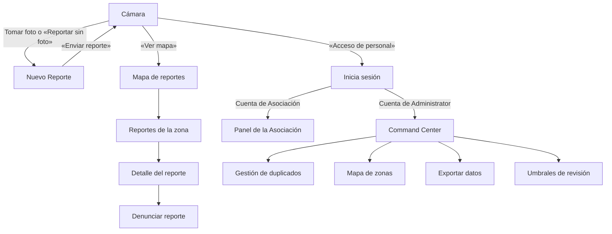

# Manual de usuario

Este manual explica, paso a paso y sin tecnicismos, cómo usar la aplicación de
reporte de perros en situación de calle. Está escrito para personas sin
formación en computación: cada término técnico se explica la primera vez que
aparece.

Notas para leer el manual:

- Los textos de botones y mensajes se escriben **entre comillas o en negritas
  tal como aparecen en la app en español**.
- Las capturas de pantalla se tomaron en un simulador de iPhone con el idioma del
  teléfono en inglés, por eso los textos de las imágenes salen en inglés. Con el
  teléfono en español la app muestra los textos en español que aparecen en las
  tablas de este manual (la app usa el idioma del teléfono: español o inglés; si
  es otro idioma, usa español).
- El botón gris con un engrane que aparece flotando en varias capturas pertenece
  a la herramienta con la que se tomaron las imágenes; **no forma parte de la
  app**.

Para quien mantiene este manual (no es necesario para usar la app): guía de la
tarea en [`docs/deployment/BACKLOG.md`](docs/deployment/BACKLOG.md), D6 y D7;
textos tomados de `i18n/locales/es.json`; capturas en `docs/manuals/img/`.

## 1. Introducción

La app sirve para **reportar perros en situación de calle** en la zona de
Creel, Chihuahua, y para **consultar en un mapa** dónde se han visto. Con esa
información, la Asociación de Hoteles de Chihuahua puede conocer dónde y cuándo
ocurren avistamientos, ataques o casos de perros lastimados, y tomar decisiones.

La usan tres tipos de persona:

| Quién | Qué hace en la app | ¿Necesita cuenta? |
|---|---|---|
| **Reportero público anónimo** (cualquier persona: turista, vecino, trabajador) | Toma una foto, llena un reporte corto, consulta el mapa y denuncia reportes falsos u ofensivos. | No. Nunca se le piden nombre, teléfono ni correo. |
| **Asociación de Hoteles de Chihuahua** (personal autorizado) | Consulta estadísticas de los reportes aceptados y los descarga en hojas de cálculo. | Sí, una cuenta que entrega el equipo técnico. |
| **Administrator** (personal autorizado) | Revisa y modera los reportes, ajusta los criterios de revisión, gestiona zonas y duplicados, y exporta datos. | Sí, una cuenta que entrega el equipo técnico. |

La Asociación y el Administrator son roles distintos, uno no está "por encima"
del otro: cada cuenta ve solo las pantallas de su rol.

## 2. Vistazo general

Fuentes: `docs/architecture/OVERVIEW.md` ("Actor boundaries"), `docs/GLOSSARY.md`.

**Qué hace la app.** Al abrirla aparece directamente la **cámara**. Desde ahí
la persona puede reportar un perro (con o sin foto), abrir el **mapa** público o
entrar como **personal**. Los reportes viajan a un servidor en la nube (una
computadora remota que guarda la información); un Administrator los revisa
antes de que aparezcan en el mapa.

**Mapa de pantallas por rol:**

**Cómo se navega:**

- El reportero público siempre regresa a la cámara: con la **X** («Cerrar») del
  formulario, con la flecha de regreso («Volver a la cámara») del mapa o con
  «Regresar» al terminar un envío.
- El personal entra con «Acceso de personal». La app reconoce el rol de la
  cuenta y abre su pantalla principal. El Administrator vuelve al Command Center
  desde las demás pantallas con «Volver a moderación». Ambas cuentas salen con
  «Cerrar sesión» y la app vuelve a la cámara.

## 3. Prerrequisitos

| Requisito | Detalle |
|---|---|
| Teléfono | Android 8.0 o más reciente, o iPhone con iOS 13 o más reciente. |
| Instalación | La app instalada en el teléfono (ver [`docs/manuals/INSTALLATION.md`](docs/manuals/INSTALLATION.md)). |
| Permiso de **cámara** | La app lo pide al abrirse por primera vez. Sin él se puede reportar sin foto, ver el mapa y entrar como personal. |
| Permiso de **ubicación** | Necesario para guardar dónde ocurrió el reporte. Sin él la app muestra «Necesitamos permiso de ubicación para registrar dónde ocurrió el reporte.» |
| Internet | **Opcional para reportar**: sin conexión el reporte se guarda en el teléfono y se envía solo cuando vuelve la señal. **Necesario** para ver el mapa, denunciar y para todas las funciones de personal. |
| Estar dentro de la zona activa | Los reportes solo se aceptan dentro de la zona geográfica activa (el área de Creel que la Asociación de Hoteles de Chihuahua aprueba). Fuera de ella el servidor rechaza el reporte. |
| Cuenta | **Solo para personal.** El reportero público no necesita cuenta. Las cuentas de Asociación y Administrator las crea el equipo técnico; la app no permite registrarse ni crear cuentas. |

## 4. Funciones — Reportero público

Formato por función: **Descripción** · **Pantalla(s)** · **Elementos de la
pantalla** (tabla elemento → para qué sirve) · **Cómo se utiliza** (pasos).

Fuentes: `screens/CameraScreen.js`, `screens/ReportDraftScreen.js`,
`screens/ReportFormScreen.js`, `screens/PublicMapScreen.js`,
`docs/diagrams/sequences/creacionreportes.md`,
`docs/diagrams/sequences/Mapareportes.md`,
`docs/diagrams/sequences/detallezonacondenuncia.md`, `docs/testing/ALPHA.md`;
capturas de referencia en `promo-video/material/`.

### 4.1 Tomar la foto y validarla

**Descripción.** La app abre directo en la cámara. Al tomar la foto, el propio
teléfono la revisa (sin internet) con un modelo de inteligencia artificial (IA:
un programa entrenado para reconocer imágenes) que comprueba dos cosas: que
**haya un perro** y que la foto **no esté borrosa**. Si pasa la revisión, la app
también calcula el **color predominante** del perro para sugerirlo en el
formulario. La foto es opcional, pero ayuda a que el reporte sea más confiable.

**Pantalla.**

En la captura la vista de la cámara aparece negra porque se tomó en un
simulador, que no tiene cámara; en un teléfono real se ve lo que enfoca la
cámara.

**Elementos de la pantalla.**

| Elemento | Para qué sirve |
|---|---|
| «Ver mapa» (arriba a la izquierda) | Abre el mapa público de reportes. |
| «Acceso de personal» (arriba a la derecha) | Abre la pantalla de inicio de sesión del personal autorizado. |
| «Toma una foto clara del perro» | Indicación para tomar la foto. |
| Botón circular blanco («Tomar foto») | Toma la foto. Mientras la revisa aparece «Validando foto…». |
| «Reportar sin foto» | Abre el formulario sin foto (ver 4.2). |
| Aviso de rechazo | Si la foto no pasa la revisión aparece «No detectamos un perro en la foto.» o «La foto está borrosa.». Desaparece solo después de unos segundos o al tocarlo. |
| «Permite el acceso a la cámara» / «Permitir cámara» | Solo aparece si la app aún no tiene permiso de cámara; el botón lo solicita. |
| Pellizcar con dos dedos | Acerca o aleja la imagen de la cámara (zoom). |

**Cómo se utiliza.**

1. Abre la app. Si es la primera vez, toca «Permitir cámara» y acepta el
   permiso del teléfono.
2. Enfoca al perro y toca el botón circular. Mantén el teléfono quieto.
3. Espera el mensaje «Validando foto…».
4. Si la foto se acepta, se abre el formulario «Nuevo Reporte» con la foto
   adjunta (ver 4.3).
5. Si aparece «No detectamos un perro en la foto.» o «La foto está borrosa.»,
   toma otra foto más cerca o con mejor luz, o usa «Reportar sin foto».

Captura pendiente: no hay captura del aviso de foto rechazada.

### 4.2 Reportar sin foto

**Descripción.** Permite hacer el reporte aunque no se pueda o no se quiera
tomar una foto (por ejemplo, si el perro ya se fue o si no se dio permiso de
cámara). El reporte se envía y se revisa igual que uno con foto.

**Pantalla.**

**Elementos de la pantalla.**

| Elemento | Para qué sirve |
|---|---|
| Recuadro «Sin foto» | Indica que el reporte no lleva foto. |
| Resto del formulario | Igual que en 4.3. |

**Cómo se utiliza.**

1. En la cámara, toca «Reportar sin foto».
2. Llena el formulario como se explica en 4.3.
3. Toca «Enviar reporte».

### 4.3 Llenar y enviar el reporte

**Descripción.** El formulario «Nuevo Reporte» pide solo datos del perro y de lo
que pasó. **No pide datos personales.** Las preguntas cambian según la
categoría (tipo de incidente) elegida. La ubicación se toma del GPS del teléfono
(el sistema de posicionamiento por satélite) en el momento de crear el reporte.

**Pantallas.**

**Elementos de la pantalla.**

| Elemento | Para qué sirve |
|---|---|
| **X** («Cerrar») | Sale del formulario y regresa a la cámara. |
| «Nuevo Reporte» y miniatura de la foto | Título. Si hay foto, «Toca la foto para verla» la muestra en grande; si no, aparece «Sin foto». |
| «Tipo de Incidente» | Lista para elegir la categoría: «Avistamiento», «Ataque a mascota», «Ataque a ganado», «Ataque a persona», «Perro lastimado» u «Otro». |
| «¿Hubo mordida?» | Solo con «Ataque a persona». Opciones «No sé», «Sí», «No». |
| «Tipo de animal afectado» | Con «Ataque a mascota» o «Ataque a ganado». |
| «¿Resultó herido?» | Solo con «Ataque a mascota». |
| «Cantidad afectada» | Solo con «Ataque a ganado». |
| «Situación del perro» | Solo con «Perro lastimado»: «Herido», «Atropellado», «Atrapado» o «Mal estado». |
| «Para esta categoría no hay preguntas adicionales.» | Aparece con «Otro»; basta con la descripción. |
| «Perro solitario o manada» | Elige «Solitario» (un perro) o «Manada» (varios). |
| «Cantidad aproximada de perros» | Solo con «Avistamiento» + «Manada». Acepta un número entero de 2 a 1000. |
| «Tamaño aproximado» | «Chico», «Mediano» o «Grande». Opcional. |
| «Color aproximado» | Círculos de colores: «Negro», «Blanco», «Café», «Gris», «Dorado», «Manchado / mixto». Si la foto lo permitió, la app sugiere uno con el mensaje «Color detectado: …. Es solo una señal; puedes cambiarlo o quitarlo.». Opcional. |
| «¿Trae collar?» | «No sé», «Sí» o «No». |
| «Descripción Opcional» | Texto libre, hasta 2000 caracteres. |
| «No ingreses datos personales» | Aviso: evita escribir nombres, teléfonos, placas, domicilios o datos privados. El reporte es público y anónimo. |
| «Enviar reporte» | Envía el reporte. Mientras tanto dice «Enviando…». |
| Ventana «Reporte enviado» | Confirma que el servidor aceptó el reporte. «Regresar» vuelve a la cámara. |
| Ventana «Reporte guardado para sincronizar» | El reporte quedó guardado en el teléfono para enviarse después (ver 4.4). |
| Ventana «Error» | Muestra un código del problema. «Volver a intentar» reintenta; «Regresar» vuelve a la cámara. |

**Cómo se utiliza.**

1. Toca «Tipo de Incidente» y elige la categoría.
2. Responde las preguntas adicionales que aparezcan para esa categoría.
3. Elige «Solitario» o «Manada»; si es manada de un avistamiento, escribe la
   cantidad aproximada.
4. Si quieres, elige tamaño, color y collar. Revisa el color sugerido: puedes
   cambiarlo o quitarlo tocándolo de nuevo.
5. Si quieres, escribe una descripción breve, sin datos personales.
6. Toca «Enviar reporte».
7. Espera la ventana «Reporte enviado» (o «Reporte guardado para
   sincronizar») y toca «Regresar».

Tu reporte no aparece en el mapa de inmediato: primero lo revisa un
Administrator.

### 4.4 Borradores y envío sin conexión

**Descripción.** Cada reporte se guarda primero en el teléfono como
**borrador local** (una copia que solo existe en tu teléfono). Si no hay
internet o el servidor no responde, el reporte queda en la **cola local** (la
lista de reportes del teléfono que esperan ser enviados) y la app lo reintenta
sola cuando vuelve la conexión, incluso si se cerró la app. Cada reporte se
envía una sola vez: reintentar no crea reportes repetidos.

**Pantalla.** El estado de la cola se muestra como un aviso en la parte de
arriba de la cámara.

Captura pendiente: no hay captura del aviso de la cola local.

**Elementos de la pantalla.**

| Elemento | Para qué sirve |
|---|---|
| «Reportes guardados para sincronizar» | Indica cuántos reportes hay en la cola local; se enviarán cuando haya conexión. |
| «Reintentar ahora» | Intenta enviar la cola en ese momento. |
| «Reintento programado» | La app esperará un tiempo antes de volver a intentar. |
| «Sincronizando reportes» | La cola se está enviando. |
| «Reportes sincronizados» | Todo se envió; «La cola local quedó al día.». |
| «Un reporte no pudo sincronizarse» | Ese reporte no se podrá enviar; si todavía hace falta, crea un reporte nuevo. |
| «Reintentar sincronización» (en el formulario) | Reenvía un reporte que quedó guardado. |

**Cómo se utiliza.**

1. Haz el reporte normalmente, aunque no tengas señal.
2. Al enviar sin conexión verás «Reporte guardado para sincronizar». Toca
   «Regresar».
3. Cuando recuperes la señal, la app envía la cola sola. Si quieres hacerlo en
   ese momento, toca «Reintentar ahora» en el aviso de la cámara.
4. Al terminar aparece «Reportes sincronizados».

La revisión de la foto también funciona sin internet. Lo único que no funciona
sin conexión es el mapa.

### 4.5 Consultar el mapa

**Descripción.** El mapa muestra los reportes **aprobados de los últimos 90
días**. Para proteger la privacidad, la ubicación de cada reporte es
**aproximada** (se ajusta a una cuadrícula de unos 50 metros). Hay dos modos:

- **Grupos (clusters):** círculos con el número de reportes de un área. Su color
  indica la gravedad más alta de esa área (por ejemplo, rojo para ataques). Al
  acercarse lo suficiente, los grupos se separan en marcadores individuales
  (pines).
- **Calor (mapa de calor):** manchas de color que muestran dónde se concentran
  más reportes; mientras más intenso el color, más reportes.

**Pantallas.**

**Elementos de la pantalla.**

| Elemento | Para qué sirve |
|---|---|
| Flecha a la izquierda («Volver a la cámara») | Regresa a la cámara. |
| Interruptor «Modo del mapa» (arriba a la derecha) | Ícono de capas = «Grupos»; ícono de llama = «Calor». |
| Brújula («Volver al norte») | Si giraste el mapa, lo vuelve a orientar con el norte hacia arriba. |
| Círculos con número | Grupo de reportes; tócalo para ver su resumen (ver 4.6). |
| Pines (marcadores con huella) | Un reporte; tócalo para ver su detalle. |
| Gestos | Pellizca para acercar o alejar (zoom) y arrastra para moverte. |
| «Para acercarte más, cambia al modo Grupos.» | En modo Calor el zoom tiene un límite; para ver más de cerca cambia a Grupos. |
| «Nuevo reporte en el mapa» / «Toca para verlo» | Aviso cuando aparece un reporte nuevo mientras ves el mapa. |
| «El mapa no está disponible sin conexión» | Aviso sin internet; «Puedes seguir creando reportes; se enviarán cuando haya conexión.». «Reintentar» vuelve a cargar. |
| «No hay reportes en esta zona» | No hay reportes visibles en el área. |

**Cómo se utiliza.**

1. En la cámara, toca «Ver mapa». El mapa se centra en tu ubicación (o en Creel
   si no está disponible).
2. Mueve el mapa con un dedo y pellizca para acercar o alejar.
3. Toca un círculo para ver el resumen de esa área; al tocarlo el mapa también
   se acerca.
4. Para ver dónde hay más reportes, toca el ícono de llama (modo «Calor»). Para
   volver, toca el ícono de capas («Grupos»).
5. Si giraste el mapa, toca la brújula para volver al norte.

### 4.6 Ver el detalle de una zona o reporte

**Descripción.** Al tocar un grupo aparece un resumen de la zona: cuántos
reportes hay, cuál es el de **mayor gravedad** y cuántos hay de cada categoría.
Desde ahí se puede ver la lista de reportes de la zona y el detalle de cada uno.

**Pantallas.**

**Elementos de la pantalla.**

| Elemento | Para qué sirve |
|---|---|
| «… reportes en esta zona» | Número total de reportes del grupo. |
| «Mayor gravedad: …» | La categoría más grave del grupo (por ejemplo, «Ataque a persona»). |
| Tarjetas por categoría | Cuántos reportes hay de cada una de las seis categorías (desliza para ver todas). |
| «Ver reportes de la zona» | Abre la lista «Reportes de la zona». |
| Lista «Reportes de la zona» | Cada fila muestra categoría, «Solitario»/«Manada» y fecha; la barra de color indica la gravedad. Toca una fila para ver su detalle. |
| «La comunidad marcó este reporte» | Indica que el reporte recibió denuncias. |
| «Las ubicaciones son aproximadas.» | Recordatorio de privacidad. |
| Detalle del reporte | Foto (si tiene), categoría, fecha y hora, «Perro solitario o manada», «Color», «Tamaño aproximado», «¿Trae collar?», descripción y respuestas de la categoría. |
| Foto | Tócala para verla en pantalla completa; la **X** la cierra. |
| «Cerrar» | Cierra el detalle o la lista. |
| «Denunciar» | Abre el formulario de denuncia (ver 4.7). |

**Cómo se utiliza.**

1. En el mapa, toca un círculo con número.
2. Revisa el resumen y toca «Ver reportes de la zona».
3. Toca un reporte de la lista para ver su detalle. También puedes tocar
   directamente un pin cuando el mapa está acercado.
4. Si el reporte tiene foto, tócala para ampliarla.
5. Toca «Cerrar» para volver al mapa.

### 4.7 Denunciar un reporte

**Descripción.** Si un reporte parece falso, ofensivo o muestra datos
personales, cualquier persona puede **denunciarlo** (marcarlo para revisión).
Cuando un reporte acumula suficientes denuncias de orígenes distintos, se oculta
automáticamente del mapa hasta que un Administrator lo revise.

**Pantalla.**

**Elementos de la pantalla.**

| Elemento | Para qué sirve |
|---|---|
| «Denunciar reporte» | Título del formulario. |
| «Motivo» | Elige uno: «Foto falsa», «Contenido inapropiado», «Burla u ofensa», «No es un perro callejero», «Contiene datos personales» u «Otro». |
| «Detalle (opcional)» | Texto libre hasta 1000 caracteres; el contador muestra cuántos llevas. |
| «Enviar denuncia» | Envía la denuncia (se activa al elegir un motivo). |
| «Cancelar» | Cierra sin denunciar. |
| Mensajes de resultado | «Gracias. Revisaremos el reporte.» (enviada), «Ya denunciaste este reporte.», «Este reporte ya no se puede denunciar.», «Enviaste muchas denuncias. Intenta de nuevo en … min.» o «Sin conexión. Intenta de nuevo.». |

**Cómo se utiliza.**

1. Abre el detalle del reporte (ver 4.6).
2. Toca «Denunciar».
3. Elige el motivo y, si quieres, escribe un detalle sin datos personales.
4. Toca «Enviar denuncia» y espera «Gracias. Revisaremos el reporte.».

## 5. Funciones — Personal autorizado

Mismo formato que la sección 4.

Fuentes: `screens/loginScreen.js`, `screens/associationDashboardScreen.js`,
`screens/AdminDataExportScreen.js`, `screens/CommandCenterScreen.js`,
`screens/ConfigurationScreen.js`, `screens/ZoneSetScreen.js`,
`screens/DuplicateManagementScreen.js`, `docs/SECURITY.md` ("Role matrix"),
`docs/diagrams/sequences/Login.md`,
`docs/diagrams/sequences/dashboardasociacion.md`,
`docs/diagrams/sequences/commandcenter.md`,
`docs/diagrams/sequences/admin-moderation.md`,
`docs/diagrams/sequences/gestionduplicados-conservarreporte.md`,
`docs/diagrams/sequences/fusionarreporte.md`.

### 5.1 Acceso de personal (iniciar y cerrar sesión)

**Descripción.** El personal de la Asociación de Hoteles de Chihuahua y el
Administrator entran con el correo y la contraseña que les entregó el equipo
técnico. La app reconoce el rol de la cuenta y abre su pantalla. La sesión se
conserva al cerrar la app hasta que la persona toca «Cerrar sesión».

**Pantalla.**

**Elementos de la pantalla.**

| Elemento | Para qué sirve |
|---|---|
| «Volver a cámara» | Regresa a la cámara sin iniciar sesión. |
| «Inicia sesión» | Título; debajo, «Ingresa con la cuenta que te proporcionó el equipo técnico.». |
| «Correo electrónico» | Campo para el correo de la cuenta. |
| «Contraseña» | Campo para la contraseña. «Mostrar» / «Ocultar» deja ver u oculta lo escrito. |
| «Entrar» | Inicia sesión. |
| «El acceso está limitado a cuentas autorizadas.» | Recordatorio de que no hay registro público. |
| Mensaje de error | «No pudimos iniciar sesión o validar el acceso. Revisa tus datos e inténtalo de nuevo.» |
| «Cerrar sesión» | En el Panel de la Asociación y en el Command Center es el ícono de salida (puerta con flecha) arriba a la derecha; en «Umbrales de revisión» es el texto «Cerrar sesión». |

**Cómo se utiliza.**

1. En la cámara, toca «Acceso de personal».
2. Escribe tu correo y tu contraseña.
3. Toca «Entrar». Se abre el Panel de la Asociación o el Command Center, según
   tu cuenta.
4. Para salir, toca «Cerrar sesión» (el ícono de salida). La app vuelve a la
   cámara.

### 5.2 Panel de la Asociación

**Descripción.** Pantalla principal de la Asociación de Hoteles de Chihuahua.
Muestra solo **reportes aceptados** (aprobados por moderación) y sus datos de
negocio: total de reportes, gráfica por fecha de aceptación y la lista de
reportes del periodo elegido. No muestra información interna de moderación.

**Pantallas.**

**Elementos de la pantalla.**

| Elemento | Para qué sirve |
|---|---|
| «Panel de la Asociación» y nombre de la cuenta | Título y organización con la que entraste. |
| Número grande «Total de reportes» | Total de reportes aceptados del periodo. |
| Ícono de salida | «Cerrar sesión». |
| «Periodo de reportes» | Filtros rápidos: «Últimos 7 días», «Últimos 30 días», «Este mes». |
| «Personalizado» | Abre «Desde» y «Hasta» con un calendario para elegir fechas; «Consultar» aplica el rango. |
| «Consulta hasta 5 años de reportes. …» | Indica el rango máximo y que se cuentan días completos según la fecha de aceptación. |
| «Reportes por fecha de aceptación» | Gráfica de barras «Por día» o «Por mes»; toca una barra para ver la fecha y cuántos reportes aceptados tiene. |
| «Reportes aceptados» | Cantidad de reportes («… reportes en este rango») y periodo aplicado («Del … al …»). |
| «CSV» y «XLSX» | Descargan los reportes del periodo (ver 5.3). |
| Tarjetas de reporte | Categoría, fecha de observación («Observado») y de aceptación («Aceptado»), «Solitario»/«Manada», «Tamaño», «Color», «Collar», «Foto disponible», «Coordenadas» e «ID del reporte» (identificador único). |
| «Anterior» / «Siguiente» | Cambian de página en la lista. |
| Mensajes | «No hay resultados en este rango.», «Revisa las fechas del rango.», «Usa una fecha válida con formato AAAA-MM-DD.», «La fecha final debe ser igual o posterior a la inicial.». |

**Cómo se utiliza.**

1. Inicia sesión con tu cuenta de Asociación (ver 5.1).
2. Elige un periodo: «Últimos 7 días», «Últimos 30 días» o «Este mes».
3. Para otro rango, toca «Personalizado», elige «Desde» y «Hasta» en el
   calendario y toca «Consultar».
4. Revisa el total, la gráfica y las tarjetas. Usa «Siguiente» para ver más
   reportes.

### 5.3 Exportar reportes (CSV/Excel)

**Descripción.** Descarga los reportes del periodo mostrado en un archivo para
abrirlo en una hoja de cálculo. **CSV** es un archivo de texto con columnas
separadas por comas que abre casi cualquier programa; **XLSX** es el formato de
Microsoft Excel. El archivo contiene exactamente los mismos reportes que la
lista, con las columnas «ID del reporte», «Fecha de aceptación», «Fecha del
reporte», «Incidente», «Avistamiento», «Detalles», «Color», «Tamaño», «Collar»,
«Longitud», «Latitud» y «Foto disponible».

**Pantalla.** Los botones están en el Panel de la Asociación (ver la primera
imagen de 5.2) y en «Exportar datos» del Administrator (ver 5.9).

**Elementos de la pantalla.**

| Elemento | Para qué sirve |
|---|---|
| «CSV» | Genera el archivo en formato CSV. |
| «XLSX» | Genera el archivo en formato Excel. |
| «Preparando archivo…» | Indica que el archivo se está generando. |
| «No se pudo guardar el archivo. Inténtalo de nuevo.» | El archivo no se guardó; repite la descarga. |

**Cómo se utiliza.**

1. Consulta el periodo que quieres descargar (ver 5.2).
2. Toca «CSV» o «XLSX».
3. Espera «Preparando archivo…» y elige dónde guardar o compartir el archivo
   en la ventana del teléfono.

### 5.4 Command Center (Administrator)

**Descripción.** Pantalla principal del Administrator. Resume los reportes de la
cola de moderación cargados en el teléfono y da acceso a las demás herramientas.

**Pantalla.**

**Elementos de la pantalla.**

| Elemento | Para qué sirve |
|---|---|
| «Command Center» | Título. El ícono de salida a la derecha es «Cerrar sesión». |
| «En esta página» | Cuántos reportes hay cargados en la cola. |
| «Prioridad alta» | Cuántos de ellos son urgentes (por ejemplo, ataques). |
| «Con banderas» | Cuántos tienen denuncias. |
| «Gestionar duplicados» | Abre «Gestión de duplicados» (ver 5.8). |
| «Gestionar zonas» | Abre «Mapa de zonas» (ver 5.7). |
| «Exportar datos» | Abre la exportación de datos (ver 5.9). |
| «Configurar umbrales» | Abre «Umbrales de revisión» (ver 5.6). |
| «Cola de moderación» | Lista de reportes por revisar (ver 5.5). Las métricas cuentan solo los reportes cargados en este teléfono, no los totales globales. |

**Cómo se utiliza.**

1. Inicia sesión con tu cuenta de Administrator (ver 5.1).
2. Revisa los números de «Prioridad alta» y «Con banderas» para decidir qué
   atender primero.
3. Toca la herramienta que necesites o desplázate hacia abajo para moderar.

### 5.5 Moderación de reportes

**Descripción.** El Administrator decide qué reportes se publican. Cada reporte
de la cola muestra solo los botones que se permiten en su estado:

- **Aprobar:** el reporte se acepta y puede aparecer en el mapa y en el panel de
  la Asociación.
- **Ocultar:** deja de mostrarse al público, pero sigue en la cola y se puede
  restaurar.
- **Restaurar:** un reporte oculto o eliminado vuelve a «Pendiente» de revisión;
  no será público hasta que alguien lo apruebe.
- **Eliminar:** es un **borrado lógico**: el reporte deja de mostrarse, pero no
  se destruye y se puede restaurar.

Ocultar, restaurar y eliminar piden un **motivo**, que queda registrado en la
auditoría (el historial de quién hizo qué y cuándo).

**Pantalla.**

**Elementos de la pantalla.**

| Elemento | Para qué sirve |
|---|---|
| Tarjeta de reporte | Categoría, fecha y hora, descripción y estado: «Pendiente», «Oculto», «Visible» o «Eliminado». |
| «Confianza» | Nivel de confianza calculado por el sistema: «baja», «media» o «alta». |
| «Banderas» | Número de denuncias recibidas (si tiene). |
| «Foto: Sí» | El reporte tiene foto. |
| Coordenadas | **Ubicación exacta** del reporte (solo la ve el Administrator). |
| «Requiere atención: se detectaron señales sospechosas.» | Advertencia del sistema. |
| «Aprobar», «Ocultar», «Restaurar», «Eliminar» | Acciones disponibles para ese reporte. |
| Ventana de motivo | «Motivo para ocultar», «Motivo para restaurar» o «Motivo de eliminación», con «Confirmar ocultar», «Confirmar restaurar», «Confirmar eliminación» y «Cancelar». |
| «Cargar más» | Carga más reportes de la cola. |
| «No hay reportes pendientes en esta página.» | La cola está vacía. |

**Cómo se utiliza.**

1. En el Command Center, desplázate a «Cola de moderación».
2. Lee el reporte, su nivel de confianza y si tiene banderas.
3. Para publicarlo, toca «Aprobar».
4. Para ocultarlo, eliminarlo o restaurarlo, toca el botón, escribe el motivo y
   toca el botón «Confirmar …» correspondiente.
5. Toca «Cargar más» para revisar más reportes.

### 5.6 Configuración de umbrales

**Descripción.** Los **umbrales** son los valores límite que usa el sistema para
revisar y proteger los reportes (por ejemplo, cuántas denuncias ocultan un
reporte). Solo el Administrator puede cambiarlos. Cada vez que se guarda se
publica una **versión nueva**; las anteriores quedan en el historial. Los
valores se muestran en el entorno en que se trabaja: «Pruebas» o «Producción».

Incluye la **detección de perro por IA**: la «Probabilidad mínima de perro» es
qué tan seguro debe estar el modelo de que hay un perro para aceptar la foto (un
valor de 0 a 1). Los teléfonos descargan el valor vigente y lo guardan; sin
internet usan el último guardado o el valor de fábrica. La revisión de la foto
sigue haciéndose en el teléfono.

**Pantalla.**

**Elementos de la pantalla.**

| Grupo / elemento | Campo | Rango permitido | Para qué sirve |
|---|---|---|---|
| «Denuncias» | «Denuncias para ocultar un reporte» | 2 a 100, entero | Cantidad de denuncias de orígenes distintos que activa la revisión. |
| «Posibles duplicados» | «Distancia entre reportes (m)» | 10 a 1000, entero | Distancia máxima para sugerir un posible duplicado. |
| «Posibles duplicados» | «Ventana de tiempo (min)» | 5 a 1440, entero | Tiempo máximo entre reportes que podrían ser duplicados. |
| «Niveles de confianza» | «Umbral de confianza alta» | 0 a 1, hasta 3 decimales | Puntuación mínima para el nivel de confianza alta. |
| «Niveles de confianza» | «Umbral de confianza media» | 0 a 1, hasta 3 decimales | Debe ser menor que el umbral de confianza alta. |
| «Precisión de ubicación» | «Precisión GPS máxima (m)» | 5 a 500, hasta 2 decimales | Si la ubicación es menos precisa, el reporte requiere revisión. |
| «Límites por hora» | «Reportes por hora» | 1 a 500, entero | Máximo de reportes nuevos por origen en una hora. |
| «Límites por hora» | «Denuncias por hora» | 1 a 1000, entero | Máximo de denuncias por origen en una hora. |
| «Detección de perro (IA)» | «Probabilidad mínima de perro» | 0 a 1, hasta 3 decimales | Valores más bajos hacen que la IA acepte al perro más fácil; valores más altos la hacen más estricta. |

| Elemento | Para qué sirve |
|---|---|
| «Versión … activa» | Número de la configuración vigente; debajo, «Último motivo: …». |
| «Motivo del cambio» | Obligatorio: explica por qué publicas la nueva versión (1 a 1000 caracteres). |
| «Guardar nueva versión» | Publica los valores como versión nueva. |
| Botón de flechas circulares («Recargar valores») | Vuelve a cargar los valores vigentes y descarta lo escrito. |
| «Consultar versión activa» | Aparece si no se pudo confirmar un guardado; revisa la versión vigente antes de reintentar. |
| «¿Descartar los cambios sin guardar?» | Aviso al salir con cambios: «Seguir editando» o «Descartar y continuar». |
| «Volver a moderación» / «Cerrar sesión» | Regresan al Command Center o cierran la sesión. |

**Cómo se utiliza.**

1. En el Command Center, toca «Configurar umbrales».
2. Cambia los valores necesarios. Si un valor está fuera de rango, la app lo
   marca (por ejemplo, «Debe estar entre … y …»).
3. Escribe el «Motivo del cambio».
4. Toca «Guardar nueva versión» y espera «Versión … guardada y activa.».

### 5.7 Zonas

**Descripción.** La **zona activa** es el área geográfica donde se aceptan
reportes. Se define con un archivo **GeoJSON** (un formato de texto estándar que
describe polígonos sobre el mapa con longitud y latitud). El proceso tiene dos
pasos: primero se guarda un **borrador** (no cambia nada todavía) y luego se
**activa**, solo después de que la Asociación de Hoteles de Chihuahua aprueba esa
versión. Al activar una versión nueva, la anterior se retira, pero sus datos e
historial se conservan.

**Pantallas.**

**Elementos de la pantalla.**

| Elemento | Para qué sirve |
|---|---|
| «Zona activa actual» | Nombre y versión de la zona vigente; «Ver detalles» muestra más datos. |
| «01 · Crear borrador» | Primer paso. |
| «Seleccionar archivo GeoJSON» | Elige el archivo de la zona desde el teléfono. |
| «Contenido GeoJSON» | Permite pegar el contenido del archivo. Acepta un Polygon o MultiPolygon, máximo 1 MiB. |
| «Calcular checksum» | Calcula la «Huella digital · SHA-256»: un código que identifica de forma única esa geometría, para que la Asociación apruebe exactamente esa versión. |
| «Nombre de la zona», «URI de la fuente original», «Versión de la fuente» | Datos de identificación y origen de la zona (la URI es la dirección web de la fuente, por ejemplo https://…). |
| «Guardar borrador» | Guarda la versión sin activarla: «Borrador guardado. La carga por sí sola no activa la zona.». |
| «02 · Activar con aprobación» | Segundo paso; se habilita cuando el servidor confirma el borrador. |
| «Referencia de aprobación de la Asociación» | Obligatoria: referencia de la evidencia de aprobación (1 a 1000 caracteres). El campo no sustituye la aprobación. |
| «Activar esta versión» | Activa la zona: «Activación confirmada. Esta versión está activa.». |
| «Consultar zona activa» | Verifica qué zona quedó activa si no se pudo confirmar el resultado. |

**Cómo se utiliza.**

1. En el Command Center, toca «Gestionar zonas».
2. Toca «Seleccionar archivo GeoJSON» o pega el contenido.
3. Toca «Calcular checksum».
4. Escribe nombre, URI y versión de la fuente.
5. Toca «Guardar borrador».
6. Comparte la versión y su checksum con la Asociación de Hoteles de Chihuahua
   para que la apruebe (fuera de la app).
7. Con la aprobación, escribe su referencia en «Referencia de aprobación de la
   Asociación» y toca «Activar esta versión».

### 5.8 Duplicados

**Descripción.** Varias personas pueden reportar el mismo perro. El sistema
**sugiere** posibles duplicados (reportes cercanos en distancia y tiempo, según
los umbrales de 5.6), pero nunca los resuelve solo. El Administrator decide:

- **Conservar:** si no son el mismo caso, se dejan sin resolver; si ya se
  resolvieron por error, se usa «Revertir resolución» y los reportes vuelven a
  revisión como independientes.
- **Fusionar:** elegir un **reporte canónico** (el que representa al caso) y
  marcar los demás como sus duplicados. No borra, combina ni modifica la
  información original de ningún reporte.
- **Revertir:** deshacer una resolución activa. Se conserva toda la información
  y el estado de moderación de cada reporte.

**Pantalla.**

**Elementos de la pantalla.**

| Elemento | Para qué sirve |
|---|---|
| «Volver a moderación» / botón de flechas circulares | Regresa al Command Center / «Actualizar candidatos y grupos». |
| «Candidatos pendientes» | Número de sugerencias por revisar. |
| «Sugerencia … · … reportes conectados» | Un grupo de reportes que el sistema cree relacionados. Desliza para ver todas las tarjetas. |
| Casilla de cada reporte | Selecciona el reporte para la resolución. |
| «Ver detalles» | Muestra más datos del reporte. |
| «Canónico» | Marca el reporte que representará al caso («Marca el círculo del reporte canónico»). |
| «Conexiones sugeridas por el sistema» | Explica por qué están conectados: número de conexiones, distancia y tiempo máximos. |
| «Revisar selección (…)» | Muestra la selección antes de confirmar. |
| «Motivo de la resolución (opcional)» | Nota de hasta 1000 caracteres. |
| «Confirmar resolución» | Fusiona: «Resolución confirmada. El grupo está activo.». |
| «Grupos activos» | Resoluciones vigentes. |
| «Revertir resolución» / «Motivo de la reversión» / «Confirmar reversión» | Deshace una resolución: «Reversión confirmada. Los candidatos vuelven a revisión; la moderación se conserva.». |

**Cómo se utiliza.**

1. En el Command Center, toca «Gestionar duplicados».
2. Revisa cada sugerencia y sus «Conexiones sugeridas por el sistema».
3. Si no son el mismo caso, no hagas nada (se conservan como reportes
   independientes).
4. Si son el mismo caso, marca al menos dos reportes conectados, elige uno como
   «Canónico», toca «Revisar selección», escribe un motivo si quieres y toca
   «Confirmar resolución».
5. Para deshacer una resolución, en «Grupos activos» toca «Revertir
   resolución», escribe el motivo y toca «Confirmar reversión».

### 5.9 Exportación del Administrator

**Descripción.** El Administrator puede consultar y descargar **los mismos
reportes aceptados que recibe la Asociación**, sin datos de moderación. Funciona
igual que el Panel de la Asociación (ver 5.2 y 5.3).

**Pantalla.**

**Elementos de la pantalla.**

| Elemento | Para qué sirve |
|---|---|
| «Volver a moderación» | Regresa al Command Center. |
| «Exportar datos» | Título; debajo, «Consulta los reportes aceptados y descárgalos en CSV o Excel. …». |
| «Total de reportes» | Total de reportes aceptados del periodo. |
| «Periodo de reportes» | «Últimos 7 días», «Últimos 30 días», «Este mes» y «Personalizado», igual que en 5.2. |
| «Descargar» | Cantidad de reportes del rango, periodo aplicado y botones «CSV» y «XLSX». |
| Tarjetas de reporte | Mismos datos que en el Panel de la Asociación. |

**Cómo se utiliza.**

1. En el Command Center, toca «Exportar datos».
2. Elige el periodo (o «Personalizado» y «Consultar»).
3. Toca «CSV» o «XLSX» y guarda el archivo.

## 6. Preguntas frecuentes (F.A.Q.)

Fuente de dudas reales: `docs/testing/UAT.md`.

**1. ¿Por qué no me deja reportar o me sale un error al enviar?**
Lo más común es que estés **fuera de la zona activa** (el área de Creel donde se
aceptan reportes) o que no diste permiso de ubicación. También puede pasar si
alcanzaste el límite de reportes por hora; en ese caso el reporte queda guardado
para reintentar.

**2. ¿Qué pasa si no tengo internet?**
Puedes tomar la foto y llenar el reporte igual. Se guarda en el teléfono
(«Reporte guardado para sincronizar») y se envía solo cuando vuelva la señal,
aunque cierres la app. El mapa sí necesita internet.

**3. Envié mi reporte, ¿por qué no lo veo en el mapa?**
Todo reporte lo revisa primero un Administrator; aparece cuando se aprueba. El
mapa muestra solo reportes aprobados de los últimos 90 días.

**4. ¿Por qué mi reporte no aparece en el lugar exacto?**
Por privacidad, el mapa público muestra una **ubicación aproximada** (se ajusta a
una cuadrícula de unos 50 metros). La ubicación exacta solo la ve el
Administrator.

**5. ¿Se guarda mi identidad?**
No. La app nunca pide nombre, teléfono ni correo, y el reporte es anónimo. Para
evitar abusos el servidor guarda un identificador técnico del dispositivo (no
dice quién eres) por un máximo de 30 días. Evita escribir datos personales en la
descripción.

**6. ¿Por qué me rechazó la foto?**
El teléfono revisa que haya un perro y que la foto no esté borrosa. Si ves «No
detectamos un perro en la foto.» o «La foto está borrosa.», acércate, mejora la
luz y vuelve a intentar, o usa «Reportar sin foto».

**7. ¿Es obligatorio poner foto, tamaño, color o collar?**
No. La foto, el tamaño y el color son opcionales; en collar puedes elegir «No
sé». Solo son obligatorios el tipo de incidente, «Solitario» o «Manada» y las
preguntas que la app marque como obligatorias.

**8. ¿El color que sugiere la app es correcto?**
Es solo una señal calculada a partir de la foto. Puedes cambiarlo o quitarlo.

**9. ¿Qué pasa cuando denuncio un reporte?**
La denuncia llega al Administrator para revisión. Si un reporte junta suficientes
denuncias de personas distintas, se oculta del mapa automáticamente hasta que se
revise. Solo puedes denunciar una vez cada reporte.

**10. ¿Cómo obtengo una cuenta de personal?**
Las cuentas de Asociación y de Administrator las crea el equipo técnico a
petición de la organización; la app no permite registrarse ni recuperar la
contraseña. Si olvidaste tu contraseña, pide ayuda al equipo técnico.

**11. ¿Cómo llego al mapa después de reportar?**
Al terminar, toca «Regresar» para volver a la cámara y luego «Ver mapa» (arriba a
la izquierda). En las pruebas con usuarios esta fue la duda más frecuente.

**12. Como Administrator, ¿eliminar un reporte lo borra para siempre?**
No. «Eliminar» es un borrado lógico: el reporte deja de mostrarse y se puede
restaurar con «Restaurar». Solo los procesos automáticos de retención borran
datos de forma definitiva, mucho tiempo después.

**13. ¿Por qué la Asociación no ve todos los reportes?**
El panel muestra solo reportes **aceptados** por moderación. Los pendientes,
ocultos o eliminados no forman parte de los datos de negocio.
