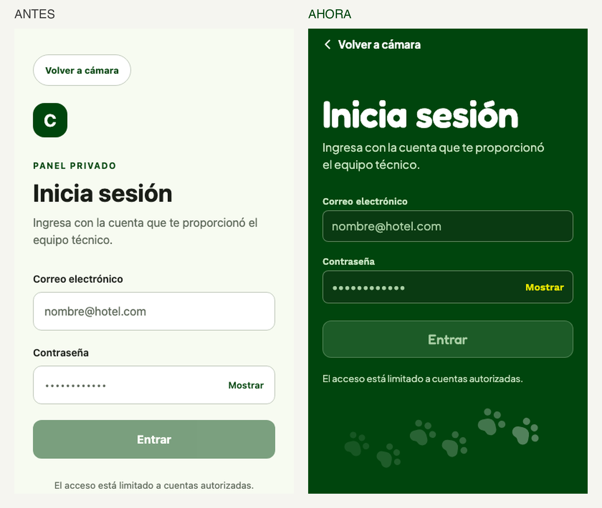

# Taste: cómo se transformó el Login y qué reglas salen para las demás pantallas

Capturas web en español (`before/web/es/login_default.png` y `after/web/es_login_default.png`). El Login se rediseñó en 6 iteraciones; este documento resume qué se rechazó, qué se aceptó y qué reglas se derivan. Los commits están en la rama `TD-134-JP-rediseno-paso0`.

## Antes → ahora

| | Antes | Ahora |
|---|---|---|
| Composición | Pantalla clara, todo apilado y alineado a la izquierda | Pantalla completa en verde de marca, título arriba, formulario al alcance del pulgar |
| Identidad | Cuadro verde con una "C" | Rastro de huellas que sube hacia la derecha, con las puntas hacia arriba |
| Tipografías | Fuente de sistema (el login no declaraba `fontFamily`) | Tres a la vez: Fredoka (título y botón), Plus Jakarta Sans (texto), Work Sans (etiquetas) |
| Acción principal | Botón verde, 12 px de radio, deshabilitado = verde pálido | Botón amarillo pelota `#e9e600` con texto verde oscuro, 12 px de radio |
| Campos | Blancos sobre fondo claro | Verde profundo `#0a3a12` con borde claro, 8 px de radio |
| "Volver a cámara" | Píldora arriba que el teclado sacaba de vista | Enlace con flecha, fijo arriba fuera del scroll |
| Teclado | El formulario se apretaba | El título se compacta y las huellas se ocultan |
| Texto pequeño | 13 px en gris | Etiquetas 13 px en Work Sans, contraste ≥ 8:1 |

## Lo que se rechazó, y por qué (en palabras del usuario)

1. **Limpieza con la misma composición** ("la neta se ve igual, ocupaba un cambio más radical"): cambiar fuente, colores y componentes sin tocar la composición no cuenta como rediseño.
2. **Encabezado verde con hoja clara redondeada** ("sigue teniendo este ai-slop feeling"): se lee como plantilla genérica.
3. **Tipografía condensada tipo señalética, curvas de nivel y amarillo fosforescente** ("así parece algo militar o muy de montañas"): la app es de perros, no de senderismo.
4. **Formulario pegado abajo, luego demasiado arriba, luego "un poco más abajo"**: el formulario va en la mitad superior-media, no anclado al fondo.
5. **Esquinas muy redondas en botones** ("las curvas de los botones, que sea menos agresiva").
6. **Espacio vacío abajo** ("abajo se ve muy vacío"): no se deja un hueco sin intención.

## Reglas para las siguientes pantallas

1. **Recomponer, no solo reestilizar.** Cada pantalla debe cambiar su estructura visual, no solo su paleta o fuente.
2. **Verde de marca a pantalla completa en las pantallas de entrada** (Login y similares). Las pantallas de trabajo con muchos datos (Configuración, Duplicados, Asociación) pueden usar fondo claro, pero con el mismo vocabulario: Fredoka en títulos, campos oscuros o de borde claro, amarillo para la acción principal. *Esto es una inferencia mía, a confirmar con la primera pantalla de datos.*
3. **Varias tipografías en una misma pantalla, cada una con rol fijo:** Fredoka = título y botón principal; Plus Jakarta Sans = texto corrido; Work Sans = etiquetas, números, enlaces pequeños.
4. **Que se note que es de perros.** Huellas como motivo recurrente (rastro, fondo, estados vacíos), puntas hacia arriba. Nada que lea como militar, montaña, señalética ni corporativo frío.
5. **Esquinas moderadas:** botones 12 px, campos 8 px, tarjetas 16 px. Evitar píldoras salvo chips y el obturador.
6. **Amarillo `#e9e600` solo para la acción principal** de la pantalla (una por pantalla). El resto de la acción en blanco, borde o verde.
7. **Sin huecos sin intención:** si queda espacio, se llena con el motivo de marca (rastro de huellas) o se reparte la composición. Nunca un bloque vacío.
8. **Posición del contenido:** el formulario o la acción principal en la zona media, al alcance del pulgar, ni pegada arriba ni al fondo.
9. **Teclado:** el encabezado se compacta y los adornos desaparecen mientras se escribe; los botones de salida (volver) nunca salen de vista.
10. **Contraste mínimo 4.5:1** en todo texto, 7:1 o más donde se pueda (uso al sol). Los estados deshabilitados se diferencian por forma/transparencia, no solo por opacidad.
11. **Sin eyebrows en mayúsculas ni insignias decorativas.** Se eliminó "PANEL PRIVADO" y la "C" del logo.
12. **Se mantiene el contrato:** testIDs, roles con nombre, textos y llaves i18n, 8 inputs de Configuración y sin desbordamiento horizontal (ver `CONTRACT.md`).

## Configuración (pantalla de datos): lo que se aprobó y lo que se rechazó

Primer intento (rechazado: "las huellas siguen amontonadas, el layout no me gusta, los botones se ven feos, se sigue viendo ai-slop"): encabezado verde con rastro de seis huellas, cada sección con un círculo con ícono, campos apilados todos iguales, barra inferior con dos botones lado a lado, uno translúcido.

Segundo intento (aprobado: "perfecto"), commit `48c404c`:
- **Un solo motivo grande, no un patrón repetido:** una huella enorme recortada en la esquina del encabezado, muy tenue. El rastro de huellas queda solo para pantallas con espacio vacío (Login).
- **Listas agrupadas en vez de campos apilados:** cada ajuste es una fila con nombre, rango y ayuda a la izquierda y el **número grande a la derecha** (Work Sans 24, verde claro). Menos scroll, se lee como tablero.
- **Títulos de sección grandes en Fredoka, sin círculos con ícono ni numeración "01, 02".**
- **Dato principal destacado:** la versión activa en amarillo, grande, en el encabezado.
- **Barra inferior con una sola acción amarilla** en una línea. La acción secundaria (recargar) pasa a **botón de ícono con borde y nombre accesible**, no a un segundo botón de texto.
- **Fondo claro para el cuerpo y verde de marca para encabezado y barra:** confirma la regla 2 para pantallas de datos.
- **Hojas inferiores en lugar de modales centrados** (descartar cambios).

### Reglas añadidas (13 a 18)

13. **Un solo elemento memorable por pantalla.** El resto sobrio. Si hay un motivo de marca (huella), que sea uno grande o un rastro con aire, nunca varios pequeños apretados.
14. **Evitar patrones repetidos de plantilla:** círculo con ícono en cada sección, tarjetas idénticas apiladas, numeración sin secuencia real.
15. **Para listas de ajustes: filas con el valor grande a la derecha** y separadores finos dentro de un contenedor agrupado.
16. **Una sola acción amarilla por barra o pantalla;** las demás, de ícono con borde o enlace. Sin botones translúcidos sobre verde.
17. **Los botones de acción principal caben en una línea** (verificar con el texto más largo en español).
18. **Revisar cada estado en captura** (cargando, sin acceso, error, campo inválido, escritorio) antes de dar la pantalla por buena.

## ZoneSet (aprobada, commits `2d6b16c` y `7d74a9d`)

- **Flujo en pasos = ruta con línea vertical y puntos** (rellenos en el paso en curso, atenuado el que espera). La numeración "01 · / 02 ·" solo se usa porque es una secuencia real.
- **Datos técnicos largos (URI, ID, huella digital) en lista agrupada y plegados detrás de "Ver detalles"**; a la vista solo lo esencial en una línea. El contenido plegado sigue en el DOM (display none), por el contrato.
- **Una acción amarilla en la barra inferior que cambia con el paso** (Guardar borrador, luego Activar esta versión).
- Mismo encabezado verde con una huella grande recortada que Configuración.

### Reglas añadidas (19 a 21)

19. **Plegar lo secundario:** si un bloque informativo empuja la tarea principal fuera del primer vistazo, se resume en una línea con un control "Ver detalles".
20. **Pasos reales = ruta con puntos y línea;** pasos inexistentes no se numeran.
21. **La barra inferior verde lleva la acción principal de la pantalla** y cambia de texto según el estado, en lugar de repetir botones dentro del contenido.

## Duplicados (aprobada, commits `1d5fc62` a `3560da5` y el de conexiones)

- **Comparar es mejor lado a lado que apilado:** cada sugerencia es una tira horizontal deslizable de tarjetas con los mismos datos en el mismo lugar; la tira llega al borde de la pantalla para que se note que se desliza.
- **Un control debe decir lo que hace:** el círculo suelto de "canónico" se rechazó; ahora es una píldora con la palabra "Canónico" que se llena al elegirla.
- **Paginar listas largas** (3 por página) con el `Pager` reutilizable; la selección persiste entre páginas.
- **Datos técnicos en bruto (pares de ID con distancia y tiempo) se resumen en una línea** ("N conexiones · hasta X m · hasta Y min") que se despliega a una tabla alineada, ordenada de la más cercana a la más lejana. Con plural correcto (`_one` / `_other`).
- **Panel de decisión verde oscuro con el único botón amarillo.**

### Reglas añadidas (22 a 25)

22. **Si la tarea es comparar, las opciones van en horizontal y alineadas;** si es leer, en vertical.
23. **Nada de iconos o controles sin palabra** cuando su función no es obvia (el radio solo).
24. **Los datos crudos se resumen y se pliegan;** el detalle se despliega a demanda, en columnas alineadas con cifras tabulares.
25. **Las cantidades llevan plural correcto** ("1 conexión", "2 conexiones") con las formas `_one` y `_other` de i18n.

## Command Center (cola de moderación)

Primer intento (rechazado: "las tarjetas se siguen viendo muy ai-slop; la posición de sign out no me convence"): cada reporte en una tarjeta con borde, chips de colores, bloque azul de ubicación y tres botones con marco; "Cerrar sesión" suelto arriba a la derecha.

Segundo intento: **una bandeja, no tarjetas.**
- Cada reporte es una **fila a todo el ancho** sobre blanco, separada por líneas finas, con **barra lateral de gravedad** (roja si es alta).
- **Señales como texto plano** en una línea (Confianza | Banderas | Foto); solo las banderas se pintan de rojo si hay. Sin chips.
- **Ubicación como línea de tabla:** etiqueta a la izquierda, coordenadas a la derecha. Sin bloque azul.
- **Acciones como barra plana al pie de la fila:** "Aprobar | Ocultar | Eliminar" separadas por líneas, sin marco; verde, ámbar y rojo.
- **Cerrar sesión como botón de ícono en la misma línea del título.**
- Las **herramientas** (duplicados, zonas, umbrales) como tres mosaicos en una fila.

### Reglas añadidas (26 a 28)

26. **Las listas de elementos de decisión van como filas de bandeja** (a todo el ancho, con separadores) y no como tarjetas apiladas.
27. **Las acciones por fila van como barra plana con texto de color,** no como botones con marco.
28. **Las acciones globales (cerrar sesión) viven en la barra del título,** no flotando solas.

### Command Center, tercera vuelta: cómo separar elementos sin tarjetas

- Filas a todo el ancho **pegadas** se funden en un solo bloque ("parece que todo es uno").
- **Tarjeta redondeada con banda de color arriba** se rechazó como plantilla genérica ("ai-slop").
- Lo que funciona: **tira a todo el ancho con líneas arriba y abajo y un hueco de fondo claro entre una y otra, sin esquinas redondeadas**, con **barra lateral gruesa** de color por estado y **número corto del reporte** (`#a1b2c3`) para que cada uno tenga nombre.
- Y **menos contenido por elemento:** se quitó la fila con etiqueta de ubicación y quedó una línea con ícono.

29. **Separar elementos de una lista con huecos de fondo y bordes finos, no con color de cabecera ni esquinas redondeadas.**
30. **Todo elemento repetido lleva un identificador corto visible** (número, nombre), no solo posición.

## Formulario (rehecho tres veces)

- **v1:** foto como encabezado grande con el título encima. Rechazado: título apretado, foto recortada y desenfocada, "muy ai-slop".
- **v2:** foto limpia con el título debajo. Rechazado: la foto sigue gastando casi 300 px y todo sigue siendo filas de botones iguales.
- **v3 (vigente):** encabezado compacto con el título y la **foto como miniatura a la derecha que se abre a pantalla completa** (idea del usuario). Preguntas cortas como **control segmentado** (una sola pieza), color como **fila de círculos con el color real del pelaje** (el nombre del elegido junto a la etiqueta), tamaño con huellas crecientes. Sin título de sección para una sola pregunta.

### Reglas añadidas (31 a 34)

31. **Una foto de evidencia es una miniatura que se abre completa**, no un encabezado enorme.
32. **Dos o tres opciones cortas = control segmentado**, no botones sueltos.
33. **Un atributo visual (color, tamaño) se elige mirando el atributo**, no leyendo una palabra.
34. **No usar el modal del sistema para hojas propias:** anima un fondo oscuro que sube y no cierra al tocar fuera; usar `Sheet` dentro de la pantalla.

## Cómo se trabaja con las skills

`frontend-design` ayudó más que el resto: obliga a planear con una paleta, roles de tipografía y un wireframe, a revisar el plan contra los defaults de plantilla y a gastar el riesgo estético en un solo lugar. `design-taste-frontend` sirve como lista de verificación (contraste, estados, etiquetas arriba del campo). `mobile-redesign-screen` da el método (auditar, proponer, arreglar). Para cada pantalla nueva: invocar `frontend-design` primero para el plan.

## Piezas reutilizables ya hechas

`theme/` (colores, tipografía, espaciado), `components/ui/` (AppButton con variante `signal`, AppTextField con `tone="dark"`, Banner, Chip, Sheet, StateView `tone="dark"`, PawTrail, Icon con refresh/copy/shield/gauge/logout), fuentes en `theme/fonts.js`.
