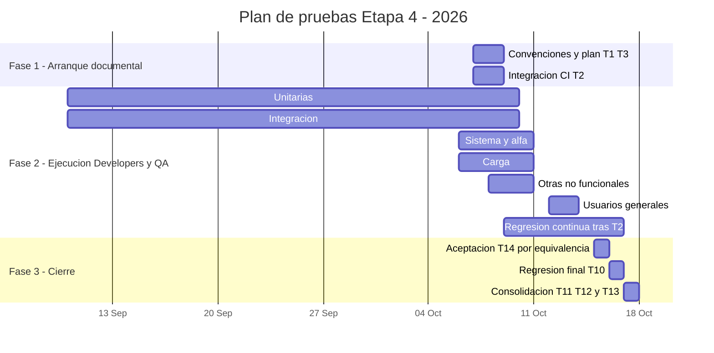

# Plan de pruebas del sistema completo

T3 / TD-116 · Responsable: Fabián Fuentes (P1).
Estado: plan revisado para integración; aprobación efectiva al fusionarse el PR.
No acredita pruebas ejecutadas.
Base revisada: `52ccef996d669c3b2ea8e894fe7f13cef1e41b39`, 2026-10-07.
T1 está integrado mediante PR #54. Fechas y horas del plan: America/Chihuahua.

## Fuentes y alcance

`docs/testing/BACKLOG.md` define tareas, responsables y dependencias.
`docs/TESTING.md` conserva la estrategia, escenarios técnicos, comandos y gates
por componente; este plan organiza cuándo, dónde y quién los verifica.
`docs/testing/README.md` define los formatos de casos, datos, ejecuciones e incidentes.

La validación comprende RF01–RF24, RNF01–RNF36 y HU-01–HU-24 de la Fase 1,
interpretados según `docs/product/APPROVED-CLARIFICATIONS.md` y
`docs/product/ETAPA1-REQUERIMIENTOS-V2.md`. T4 documenta las relaciones en
`docs/TRACEABILITY.md`; cada exclusión o brecha requiere justificación y responsable.

- Reportero público: cámara, foto opcional y validación/color en dispositivo,
  formulario dinámico, reporte sin datos personales, cola offline y sincronización,
  mapa aproximado, detalle y denuncia (T5).
- Asociación de Hoteles de Chihuahua: sesión, estadísticas y exportación de datos
  aceptados canónicos. Administrator: sesión, moderación, duplicados, configuración
  y administración de zonas. Son roles hermanos; probar permisos positivos y
  negativos (T6).
- Transversales: integridad, RLS y privilegios, privacidad, saneamiento de imágenes,
  límites de tasa, auditoría, retención, idiomas, accesibilidad, rendimiento y
  compatibilidad. T7 verifica la app en Android; T8 incorpora usuarios; T9 reúne
  evidencia RNF; T14 se planeó para recoger la visión y conformidad del socio
  formador; por decisión del equipo (2026-10-12 y 2026-10-13) la ejecutó el
  equipo y la registró por equivalencia con la alfa T7, sin conformidad del socio
  (`docs/testing/ACCEPTANCE.md`).

Fuera de alcance: implementar embeddings/pgvector o GPU de Fase 2 (RNF35 se
verifica por inspección), certificación de un SLA productivo sobre Free, carga
masiva o destructiva, activar geometría como oficial sin aprobación de Asociación,
y ejecutar despliegues o migraciones por el mero hecho de aprobar este plan.
Expo Go y las exportaciones de bundles no sustituyen aceptación de módulos nativos.

## Personas y roles

Los cinco integrantes cumplen Developers al mantener pruebas de los componentes
que desarrollan. Para esta etapa, la distribución operativa sigue el backlog:

| Persona | Integrante | Developers | QA y coordinación de pruebas |
|---|---|---|---|
| P1 | Fabián Fuentes | Revisión de pruebas de configuración, zonas y duplicados; trazabilidad T4 | Plan T3, convenciones T1 y entregable T13 |
| P2 | Juan Pablo De León Gómez | Suite completa y CI T2 | Responsable de alfa T7 y regresión final T10; abre incidentes de main |
| P3 | Erick Herrera Luna | Casos y pruebas del reportero público T5 | Ejecuta T5 y consolida incidentes T11 |
| P4 | Alan Ruiz Silva | Casos y pruebas de mapa y roles T6 | Ejecuta T6, consolida resultados T12 y facilita aceptación T14 |
| P5 | Ricardo Becerra Bitar | Soporte de tests de seguridad, sesión y otros RNF | Facilita usuarios T8 y ejecuta no funcionales/carga T9 |

QA operativo: P2, P3, P4 y P5; P1 coordina documentación y trazabilidad.
En alfa participa todo el equipo, coordinado por P2. Los usuarios externos ejecutan
T8; sus facilitadores registran las evidencias. T14 la ejecutó el equipo y quedó
registrada por equivalencia con T7 (decisiones 2026-10-12 y 2026-10-13,
`docs/testing/ACCEPTANCE.md`).

## Tabla del plan

Las fechas del profesor se conservan del backlog (2026). Las fechas adicionales
marcadas como propuesta se someten a revisión del equipo en este PR. Son ventanas
planificadas: las fechas reales se anotan en `docs/testing/TEST_LOG.md` y una ventana
vencida no demuestra ejecución. Si una dependencia no está cumplida, reprogramar
la tarea y registrar el bloqueo, sin darla por terminada por calendario.

| Qué | Dónde | Cómo | Quién | Cuándo | Herramienta |
|---|---|---|---|---|---|
| Pruebas unitarias | Móvil: `models/`, `services/`, `controllers/`, `hooks/`, `i18n/`, `scripts/`; API: `supabase/functions/api/domain/` y `supabase/functions/api/services/` | Automatizada; límites, valores representativos y excepciones | Developers P1–P5; P3/T5 y P4/T6 incorporan los casos | 10 sep–9 oct 2026 (profesor) | Deno test y node:test |
| Pruebas de integración | HTTP Hono en `supabase/functions/api/controllers/` y `supabase/functions/api/tests/`; adaptadores en `services/`; PostgreSQL/PostGIS local aislado | Automatizada; distinguir repositorio/sesión simulados de SQL y JWT reales | Developers P1–P5; P2 mantiene la ejecución común en T2 | 10 sep–9 oct 2026 (profesor) | Deno test, node:test, PostgreSQL/PostGIS |
| Pruebas de sistema | UI en `tests/ui/`; app completa en Android con API staging | Automatizada en navegador y manual alfa de flujos completos | QA P3/T5 y P4/T6; P2/T7 coordina alfa con todo el equipo | 6–10 oct 2026 (profesor) | Playwright, build nativo y casos en `docs/testing/ALPHA.md` |
| Pruebas de regresión | Todo el repo; PR y main; corrida final sobre main | Suite automática por PR/main al integrar T2; repetir tras correcciones; final T10 | CI mantenida por P2/T2; P2 ejecuta y registra T10 | Continua en cada PR/main; final 16 oct 2026 (propuesta, después de T14 y sus correcciones); por decisión del equipo (2026-10-12) T10 no esperó a T14 y corrió el 12 oct (CI-11 a CI-20, `docs/testing/TEST_LOG.md`) | GitHub Actions y npm test previstos por T2; comandos actuales de `docs/testing/BACKLOG.md` mientras T2 no esté integrado |
| Pruebas de carga | API staging: GET /health, GET /public/clusters, GET /public/reports | Automatizada, ligera y corta, solo lectura; peticiones, p95 y tasa de error | QA P5/T9 | 6–10 oct 2026 (profesor) | k6; scripts previstos en `tests/load/`; evidencia en `docs/testing/NON-FUNCTIONAL.md` |
| Otras no funcionales | Móvil y API: rendimiento, compatibilidad, accesibilidad, seguridad y operaciones | Mixta: tests, medición en teléfono e inspección documental | QA P5/T9; Developers apoyan con tests y datos | 8–10 oct 2026 (propuesta) | Cronómetro, TalkBack, tests existentes e inspección; `docs/testing/NON-FUNCTIONAL.md` |
| Pruebas con usuarios | App móvil en entorno de prueba; reporte, mapa y denuncia | Manual con 3–5 personas externas, consentimiento, tiempos y encuesta | Usuarios generales; QA P5/T8 facilita | 12–13 oct 2026 (propuesta; preferentemente tras alfa T7) | Guion, cronómetro y encuesta en `docs/testing/UAT.md` |
| Pruebas de aceptación | App móvil con datos de prueba revisados; flujos de negocio seleccionados | Manual, ejecutada por el socio; registrar conformidad explícita. Por decisión del equipo (2026-10-12 y 2026-10-13) la ejecutó el equipo y se registró por equivalencia con T7, sin conformidad del socio | Equipo de desarrollo; QA P4/T14 responsable | 15 oct 2026 (profesor; requiere T5, T6 y T7); registrada el 13 oct 2026 por equivalencia | Casos y conformidad en `docs/testing/ACCEPTANCE.md` |

## Gantt por fases y niveles

Las ventanas abarcan ambos días indicados en la tabla. Mermaid usa el final de
cada barra como límite exclusivo: por ejemplo, 2026-10-10 cubre hasta el 9 de octubre.
Arranque y cierre son propuestas; unitarias e integración muestran la ventana del
profesor iniciada en septiembre, anterior a la formalización documental de T1/T3.
No hay marcas de pruebas completadas basadas solo en fechas.

El 9 de octubre es la activación propuesta de CI tras T2, no una afirmación de
que ya existe. T10 del 16 y el cierre del 17 solo proceden si sus dependencias
están hechas: T10 necesita T2, T4–T9 y T14, con las correcciones fusionadas;
T11/T12 consolidan después de T10 y T13 requiere T3, T11 y T12. Si una falla de
aceptación requiere más tiempo, mover T10 y el cierre; la fecha no sustituye el gate.

## Entornos y evidencias

| Entorno | Uso | Límite de la evidencia y preparación |
|---|---|---|
| Local | Deno/node:test, navegador Playwright, integración simulada y SQL opt-in | Registrar commit, runtimes y versión de navegador; HTTP interceptado no prueba API desplegada. Cada suite SQL usa su base y cluster nuevos desechables según `docs/TESTING.md`, nunca la base compartida |
| CI | Suite común por PR/main y regresión final | T2 está pendiente en la base revisada: no existen workflow ni comando npm test unificado. Solo afirmar integración al enlazar el PR y una corrida real; documentar SQL omitido y su evidencia local separada |
| Staging | API desplegada, sesiones reales, lectura y flujos revisados | Usar el proyecto de prueba existente, comprobar API/build, perfil, rol y geofence TEST ONLY según `docs/DEPLOYMENT.md`; credenciales fuera de Git. Identificar datos y efectos antes de ejecutar; cargas solo GET |
| Dispositivo | Alfa, TFLite/color, offline, permisos, teclado, selector, TalkBack, compatibilidad y usuarios/aceptación | Android real y build nativo para T7; identificar modelo/OS, idioma/red y versión. Verificar objetivos Android 8+ e iOS 13+ de RNF05; si no hay iPhone o build compatible, dejar iOS sin cubrir con responsable y justificación |

La prueba con sesiones reales de 2026-10-01 consta como antecedente en
`docs/TESTING.md` y `README.md`; no es una nueva ejecución de esta etapa ni sustituye
alfa en teléfono. Cada corrida se vincula a la versión realmente ejecutada.

## Criterios de entrada y salida

Antes de cada ejecución: versión fijada, dependencia cumplida según
`docs/testing/BACKLOG.md`, caso con TC y fuente contractual, entrada reproducible,
resultado esperado comprobable y ejecutor asignado. Preparar entorno y datos;
registrar qué está simulado. Antes de T8 obtener consentimiento; antes de T14,
T5/T6/T7 hechos y guion acordado con el socio. T8 después de alfa es recomendación,
no dependencia adicional impuesta al backlog.

Para cerrar una tarea de ejecución, sus casos llevan filas RUN en
`docs/testing/TEST_LOG.md`, evidencia accesible y límites explícitos. Ante una
falla, abrir INC y bug Jira al detectarla, corregir y verificar con una nueva fila.
CI de PR en rojo se corrige en ese PR; fallas de main generan incidente por P2.
Las corridas main/final llevan una fila por suite CI con aprobadas/fallidas/omitidas.

Para cerrar la etapa: matriz T4 completa para RF/RNF/HU, gates pertinentes de
`docs/TESTING.md` respaldados, resultados T5–T9 y T14 registrados, correcciones
integradas y corrida T10 en verde sobre el commit de entrega. Una suite omitida
no cuenta como aprobada: debe tener justificación y evidencia alternativa o quedar
como brecha que impide afirmar ese gate. T11/T12 consolidan sin ocultar bloqueos;
T14 conserva conformidad y observaciones del socio. T13 enlaza los cuatro entregables.

Cierre de T3: ocho filas con fecha, personas Developers/QA, Gantt, alcance,
entornos, criterios y riesgos; enlace desde `docs/TESTING.md`; aprobación y fusión
del PR según el backlog. Aprobar el plan no acredita que se cumplieron los gates.

## Riesgos y respuesta

| Riesgo | Impacto | Respuesta y responsable |
|---|---|---|
| T2 aún pendiente o fechas de ejecución ya en curso | No hay regresión automática común ni evidencia retroactiva | P2 integra T2; P1 actualiza el calendario con bloqueos. Usar comandos vigentes y registrar fechas reales; T3 no implementa CI |
| Una falla del 15 deja poco margen antes de T10 | Regresión final sobre código incompleto | P4 registra hallazgo; responsable corrige; P2 reprograma T10 hasta tener T14 y correcciones integrados; P1 ajusta cierre |
| Mocks/navegador cubren menos que API y teléfono | Falsa aceptación de JWT, SQL, offline o módulos nativos | P2 coordina alfa; P3/P4 distinguen evidencia simulada de SQL/staging; no trasladar éxitos entre entornos |
| Cuotas, pausa o datos compartidos en Supabase Free | Pruebas interrumpidas o efectos sobre datos ajenos | P5 revisa cuota/estado antes de carga y limita duración/peticiones; equipo prepara datos identificados. RPO/RTO/SLA de producción no se deducen del prototipo |
| Compatibilidad real con OS mínimo o falta de iPhone | RNF05 sin evidencia | P5 inspecciona soporte del build y prueba dispositivos disponibles; reporta brechas sin cambiar silenciosamente el requerimiento |
| Faltan usuarios o disponibilidad del socio | T8/T14 no ejecutados | P5 coordina 3–5 voluntarios y P4 confirma sesión del 15; P1 actualiza fechas si no se confirma, sin fabricar conformidad |
| Secretos, datos personales o geometría de prueba presentada como oficial | Seguridad, privacidad o aceptación inválida | Cada ejecutor anonimiza evidencia y usa cuentas/datos revisados; P1 verifica documentación; respetar `docs/SECURITY.md` y `docs/DEPLOYMENT.md` |

## Revisión y aprobación del plan

Autor: Fabián Fuentes. Revisión propuesta: P2 para CI/alfa/regresión, P4 para
casos/aceptación y P5 para no funcionales/usuarios. No se atribuye aprobación a
ninguno sin evidencia del PR. Fechas adicionales sujetas a esa revisión.
PR: [#55](https://github.com/CardozoPapaDelAme/dog_report_app/pull/55).
Entrega revisada y merge autorizado por Fabián el 2026-10-07, condicionado a
que cumpla T3. Aprobación del plan efectiva al fusionarse el PR. Las fechas
adicionales son calendario propuesto: confirmar disponibilidad con los responsables
y reprogramar cuando una dependencia o hallazgo lo requiera. No se atribuye
conformidad a otros integrantes ni al socio formador.
